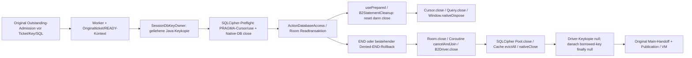

# §100 – Issue #32: vollständige Abnahmematrix

Basis `21280f6de134216d3a429fc314c0fa428f999dc3`, Branch
`p11-performance-optimization`, 24.10.2026. Primär #32, Abhängigkeiten #33/#37/#44.

**Ergebnis: bereit zur unabhängigen Schließungsprüfung von #32.** Die fünf
technischen Akzeptanzkriterien haben im unten ausdrücklich benannten Umfang
belastbare Belege. Das sechste Kriterium – unabhängiger Review vor produktiver
Snapshotfreigabe – bleibt **BLOCKED / ausstehend**. Issue nicht eigenständig schließen.
Kein neu reproduzierter Produkt-Cleanupdefekt, daher **kein Produktfix**.
Keine universelle Leakfreiheit, vollständige native Speicherlöschung oder harte
Gesamtprozessobergrenze behauptet. Alle Aktivierungs-/Releasegates bleiben bestehen.

## Maßgebliche Kriterien und vorhandene Belege

Die tatsächliche [Issuebeschreibung und Kommentarhistorie](issue32-source.json)
wurden von GitHub gelesen, insbesondere der unabhängige §88a-Review. Die alte
Befundzeile „B2Driver ergänzt keine Freigabe“ ist seit §72 überholt: der vorhandene
`B2StatementCleanup` versucht reset vor close. Die SQLCipher-4.19.1-Asymmetrie
bleibt als negativer Vendor-Control gültig; sie ist kein heute unbehandelter
Produktdefekt. Die frühere §82/§83-Grenze T8 ist durch §91a/Option 2 ersetzt.

| Akzeptanzkriterium #32 | Vorhandener Beleg | Zuvor fehlender Nachweis | §100 Test/Fix | Status |
| --- | --- | --- | --- | --- |
| 1. Lebensdauer usePrepared → Room-Readtransaktion → Room-Close → B2/Native-Close → Key-Lease dokumentieren und isoliert validieren | [§82 Ressourcenpfad](../p11-p82/resource-lifetime.md), [§88a Bytecode und drei Gerätefälle](../p11-p88a/assessment.md) | Aktueller durchgehender Nachweis einschließlich nativer Pool-/Connection-/Statementcache-Enden hinter bloßen Closed-Flags | Alle sechs neuen Szenarien, einschließlich originalem Runtime-Core; zusätzlich starke diagnostische Aliase auf Preflight-/Room-Verbindungen, Pointer- und Cache-Endprüfungen | **PASS** für erfasste Readscopes und bekannte Handles; kein globaler Heap-/Wipevertrag |
| 2. Wiederholte Multi-Batch-Reads, Budgetverweigerung, Revoke, SQL-Exception, Sperre, Cleanupfehler betrachten | §82 Fehler-/Revoke-/Rollbackmatrix; §88a Paging/Revoke/SQL-Overflow | Aktuelle R8/T16-Grenzen, wiederholte große Reads, Cancellation mit noch laufendem Worker; echter Produkt-Budgetfehler; tatsächliche BLOCKED-Policy nach SQL-Fehler | 3 getrennte Multi-Batch-Scopes; vier exakte Admissiongrenzen; Produkt-Refusal vor Payload; Lock/Cancel im gehaltenen Rowloop; SQL-Overflow; explizit injizierter Post-Room-Closefehler mit FAILED_OR_UNCONFIRMED | **PASS** für diese benannten Fälle. Echter Vendor-Closefehler nicht reproduziert und nicht aus UNKNOWN abgeleitet |
| 3. Statementcursor, CursorWindow, Native/FD und Lease-Cleanup getrennt bewerten, Messgrenzen nennen | §88a Cursor/Window-Enden und Prozesssamples | Nativer Pool kann trotz DB-isOpen=false noch Verbindungen halten; aktuelle FD-/Native-/PSS-/ART-Proben bei Wiederholung | Getrennte Zähler, gehaltene Native-Connection-Pointer und Cachezustände, Preflight/Room/Driver/Lease, FD-Readlink-Klassifikation, Samples vor/während/nach Scopes und nach Activityfinish | **PASS** als getrennte Bewertung und konkrete Handle-Endbeobachtung, ausdrücklich keine zertifizierte Maximalbelegung |
| 4. Konkreten Leak/fehlendes Cleanup ggf. minimal mit Regression beheben; kein spekulativer Driverumbau | §72 bestehender Cleanupfix, [§88a nackter Vendor-Control](../p11-p88a/paging-02.txt), vier Hostregressionen | Prüfen, ob aktueller Projektpfad einen weiteren fehlenden Abschluss zeigt | Kein neuer Defekt reproduziert; vorhandener Abschluss bleibt wirksam. Keine Änderung produktiver Quellen | **PASS**, kein zusätzlicher Fix erforderlich |
| 5. Fixture-deleteRecursively-Ergebnis getrennt prüfen, Reste offenlegen | Seit §71 ersetzt der [Fixture-Rootguard](../../data/src/debug/kotlin/org/pag/data/product/P11FixtureRoot.kt) unkontrolliertes deleteRecursively; vier negative/positive Hostfälle | Aktuelle tatsächliche Close-Rückgabe und Abwesenheit der Roots auch in allen neuen Fehlerfällen | Pro Gerätefall Harness-closeConfirmed erst nach Fixture.close-Rückkehr, ursprüngliche Root anschließend absent; externe run-as-Inventur; Hosttests für false/behaupteten Erfolg mit Rest/Rootersatz | **PASS** für ausgeführte Scopes. Keine Lösch-/TOCTOU-/Konstruktor-OOM-Universalaussage |
| 6. Unabhängiger Review vor produktiver Snapshotfreigabe | Unabhängige Teilreviews §§82–99a | Unabhängige Prüfung dieser vollständigen Matrix und ihrer Rohbelege | Dieser WIP mit unveränderten Gates, danach STOPP | **BLOCKED – unabhängiger Review ausstehend**; technischer Abschlusskandidat, keine Produktfreigabe |

„PASS“ gilt jeweils für den präzisierten Vertrag, nicht für sämtliche denkbaren
Vendor-/Hardware-/OOMfehler. Ein tatsächlich vor Freigabe fehlschlagendes natives
reset/close wurde nicht beobachtet; seine generelle Beherrschung wird **nicht**
als erfolgreich ausgeführter Vendorfall ausgegeben. Die Fehlerbehandlung wurde
an realem SQL-Fehler und klar bezeichneten synthetischen Cleanupfehlern betrachtet.
Sollte der unabhängige Review darüber hinaus eine konkrete reale Vendor-Close-
Fehlerreproduktion verlangen, ist genau diese Lücke offen: eine reproduzierbare
vor-nativer-Freigabe-Fehlerquelle an der eingebundenen 4.19.1-Version beschaffen
und den Originalpfad prüfen; keine Post-Close-/UNKNOWN-Injektion dafür umetikettieren.
Das ist weder eine hier erfolgte zusätzliche Sicherheitsentscheidung noch ein
Grund, alle übrigen belegten Kriterien erneut als ungeprüft zu behandeln.

## Konsolidierung §§82–99a, ohne alte Tests umzudeuten

| Historischer Umfang | Verwendung hier / Abgrenzung |
| --- | --- |
| [§82](../p11-p82/results.md) | 29 akzeptierte gezielte Läufe; 14 frühe ungültige Harnessläufe ausdrücklich ausgeschlossen. Revoke vor END mit tatsächlichem Rollback, primäre/suppressed Fehler, synthetische Post-reset/close/Room-/Driver-/Keyfehler. Kein echter Vendor-Closefehler daraus abgeleitet. |
| [§83](../p11-p83/results.md), [§84](../p11-p84/results.md) | Beobachtete offene/geschlossene Windows und DB-/Keyenden sowie exklusiver Outstanding-Übergang. Historisches T8-Refusal bei 100 Rollen ist **kein** heutiger T16-Nachweis. Gemeinsame Gesamt-RAM-/Consumer-Endfreigabe wurde damals verweigert. |
| [§85a](../p11-p85a/assessment.md), [§85b](../p11-p85b/assessment.md) | ≤32 Historyevents je Seite, echte History-/SQL-Fehler-/Lockpfade. TEMP-B-TREE/native Sortierkosten sind keine gebuchten Nullkosten; keine 129k-Serie wiederholt. |
| [§86a](../p11-p86a/assessment.md), [§86b](../p11-p86b/assessment.md) | Fehlender Consumer-Endnachweis und Fullview-Machbarkeits-/Speichersamples sind nicht mit DB-Cleanup gleichzusetzen; keine Fullview-Fallbackfreigabe. |
| [§87a](../p11-p87a/assessment.md) | Aktuell maximal 5.000 reguläre TaskEvents; aktuelle Stressfixture enthält tatsächlich 5.000, nicht 129k. |
| [§88a](../p11-p88a/assessment.md) | Tatsächliche usePrepared/reset/close/Window-Kette, natives Overflowstatement und Vendor-Control wiederverwendet statt neu erfunden. |
| [§89a](../p11-p89a/assessment.md), [§90a](../p11-p90a/assessment.md), [§91a](../p11-p91a/assessment.md) | Frühere globale 8+8-/Consumer-End-NO-GOs bleiben historisch korrekt. Heute R8/T16 ausschließlich app-kontrollierte Daten; Framework-/SQLCipher-/Nativekosten separat. |
| [§92a](../p11-p92a/assessment.md)–[§96a](../p11-p96a/assessment.md) | Vier widerrufbare kompakte Handles, keine produktive direkte Core-Ausgabe. Kein nativer Cleanup- oder RAM-Reusebeweis allein durch Handle-Invalidierung. |
| [§97a](../p11-p97a/assessment.md)–[§99a](../p11-p99a/assessment.md) | Lokale VM-Scopes und tatsächliche Worker-/Main-ACKs sowie terminal entkoppelte Shells bleiben unverändert. Alter Read-Testalias/Lifetime-Owner-/Fullview-/Formulargraph weiterhin eigener #37-Befund. Kein neues Retirement nach Exposition. |

## Tatsächlicher Produktpfad und Endpunkte

[Reader](../../data/src/main/kotlin/org/pag/data/product/ProductActiveCoreReader.kt),
[ActionDatabaseAccess](../../data/src/main/kotlin/org/pag/data/product/ActionDatabase.kt),
[B2Driver](../../data/src/main/kotlin/org/pag/data/prototype/b2/B2Driver.kt),
[Statementcleanup](../../data/src/main/kotlin/org/pag/data/prototype/b2/B2StatementCleanup.kt),
[Keyowner](../../data/src/main/kotlin/org/pag/data/product/SessionDbKeyOwner.kt).
Die vorhandene positive `cleanupConfirmed`-Bedingung verlangt Room-Ende,
Coroutine-Ende und `driver.resourcesClosed()`. Ein unerwarteter Readerfehler
bleibt unabhängig davon konservativ unbestätigt. Nach SQL-Fehler und injiziertem
Post-Room-Closefehler: Runtime **BLOCKED**, Originalticket widerrufen, kein Core,
Transition weiter reserviert. Budgetrefusal bleibt hingegen **READY**, ohne Payloadzeile.

Die tatsächlich benutzten AARs sind unverändert gegenüber §88a:
SQLCipher 4.19.1, Room 3.0.3; [SHA-256](vendor-artifacts.json).
Der [Close-Bytecode](vendor-close-chain.txt) zeigt auch eine wichtige Grenze:
`SQLiteDatabase.isOpen=false` bedeutet zunächst, dass sein Poolfeld null ist.
Der Pool kann noch erworbene Verbindungen abwarten und fängt gewisse native Close-
RuntimeExceptions intern zum Logging ab. **Deshalb hier kein Native-Endbeweis
allein aus diesem Flag oder aus Kotlin-use.**

Die neue Diagnose erfasst den bereits autorisierten Preflight über die genaue
Fixture-DB in der Vendor-Active-Map und Room-Verbindungen über die vorhandene
Statementseam. Sie hält die gefundenen DB-/Pool-/Connectionobjekte **stark**,
begrenzt auf 16 DBs/64 Verbindungen gleichzeitig (tatsächlich je ein Pool mit
Primärverbindung), und prüft nach realem Close:

- DB-isOpen false, Pool nicht offen, keine verfügbaren oder erworbenen Verbindungen;
- **mConnectionPtr==0** der vorher erfassten Connectionobjekte;
- deren Prepared-Statement-Cache **size()==0**;
- erfasste Statementcursor geschlossen, Windowpointer null;
- erst danach Aufgabe der diagnostischen Aliase.

Die WeakMap dient nur zum Auffinden des aktiven Preflightobjekts; **ihr Leeren,
WeakReferences oder GC dienen nicht als Endbeweis**. Auch diese konkreten nativen
Handle-Enden sind keine vollständige Allocator-/Key-/Klartext-Wipegarantie.
Preflight-PRAGMA-Cursor verwenden weiterhin scoped close; deren einzelne Windows
werden nicht separat reflektiert. Der anschließend explizit beobachtete Abschluss
von Preflightpool, Connectionpointer und Cache ist ihr zusätzlicher nativer Scopebeleg.

## Neue isolierte Gerätefälle

SM-M526BR / Android 13, API 33, arm64-v8a, freigegebenes Gerät RFCT1186YRJ;
[Fingerprint](device-fingerprint.txt). Eigener exakter P77-Target/Test-Package/Runner,
Manifest-/Signatur-/Geräteprüfung vor Installation. Echter ProductRuntime,
SessionCoordinator, originaler Keyowner, Room/SQLCipher/B2 und Produkt-Reader/Loader.
Synthetische Authentifizierung ist keine OS-Keyguard-/Credential-Abnahme.
Alle neuen Original-Core-Läufe haben `reuseEnabled=false` und `ramReuseEnabled=false`.

| Rohbeleg | Inhalt |
| --- | --- |
| [repeat-boundary-02](repeat-boundary-02.txt) | Drei nacheinander vollständig geschlossene **nicht exponierende** DB-/Room-/Java-Keyscopes derselben originalen Runtime. Je 200 Personen in 7 und 1.000 Tasks in 32 SQL-Batches, pro Query höchstens 32, jedes Pseudonym/Title mit langem Ä界🦋-Präfix geprüft. Tatsächlicher COUNT=5.000 Events. Anschließend vier exakte R8/T16-Grenzproben; danach genau ein originaler Product-Core-Read mit 32/32 Karten und korrekten 200/1.000-Zählern. Lock nach Exposition, zweite Admission DENIED. |
| [lock-02](lock-02.txt) | Erster wirklicher PEOPLE_ROW mit geöffnetem Cursor/lebender Lease kontrolliert angehalten; Mainthread lockt synchron. Originalticket sofort tot, zweite Admission noch während laufender Arbeit DENIED. Erst nach tatsächlicher Rückkehr DB-/Lease-Enden und bestehendes ungepubliziertes Retirement. |
| [cancel-02](cancel-02.txt) | Derselbe laufende Read, echte `activeCore.cancelPending()` statt Sessionlock. Keine neue Session-/Ticketauthorität; Session READY, Access-Revoke, tatsächlicher Workerabschluss erforderlich. |
| [sql-error-02](sql-error-02.txt) | Im originalen Produkt-Reader-Room-Scope geöffneter äußerer Cursor und echtes `SELECT abs(-9223372036854775808)`. Vendor-step scheitert; bestehende Sanitization, BLOCKED und unbestätigtes Outstanding-Fence. Kein zusätzlicher Vendor-Closefehler behauptet. |
| [cleanup-unknown-02](cleanup-unknown-02.txt) | Explizit **injizierte Exception NACH tatsächlicher Room.close-Rückkehr**. Driver-/Key-/Cursorenden trotzdem beobachtet; Produkt markiert die Operation FAILED_OR_UNCONFIRMED, BLOCKED, zweite Admission DENIED. Kein realer Vendor-Closefehler und kein Writer-UNKNOWN/Commit-Test. |
| [budget-refused-01](budget-refused-01.txt) | 200/1.000/5.000-Stressbestand plus isoliert gesäte 250.000-Byte-Aktionsbeschreibung: tatsächlicher Produkt-Reader meldet BUDGET_REFUSED, **keine erste Payloadzeile**, Session READY, danach bekannte Ressourcenenden. Nicht mit der früheren T8-100-Rollen-Verweigerung verwechselt. |

Die wiederholten kontrollierten Scopes lesen mit **originalem Runtime-READY-Kontext
und Keyowner**, geben nur skalare Testbelege zurück und publizieren keinen Core.
Sie setzen nie das exponierte Outstanding-Fence zurück. Es ist kein neuer
Produkt-Lade-/Cacheport und keine alternative Session-/Keyautorität.
Die Produktions-Publication-/Ticket-/Writer-Verträge werden daraus nicht neu abgeleitet;
der originale Core-Lauf und die bestehenden Lifetime-/Outstanding-Hostfälle prüfen diese.

### Exakte Grenzen und echter Produkt-Refusal sind verschiedene Belege

Die vier exakten Grenzfälle bereiten echte CompactPeople-/CompactTask-Pläne in
Room vor und verwenden die unveränderte **gemeinsame CoreReadAdmission** plus
disjunkte konservative **Test-Overheadmetadaten**, nicht eine aufgeweichte Quote.
R=8.388.608 bzw. T=16.777.216 ist jeweils ADMITTED, beide echten Planmaterializer
laufen. Bei jeweils **+1 Ledgerbyte**: BUDGET_REFUSED, **0 Materializeraufrufe**.
Keine entsprechende native/allokierte 16-MiB-Testlast wird behauptet. Ein zusätzliches
SQL-Textbyte verändert aufgrund der vorhandenen Schätzfaktoren mehrere Ledgerbytes;
deshalb ist die separate 250k-Beschreibung der tatsächliche Produkt-Refusalbeleg,
nicht ein vorgetäuschter natürlicher +1-Ledgerbyte-Datensatz.

## Konkrete Enden, nicht Prozessdelta-Beweise

[Strikt validierte Zähler](device-summary.json), [Auswertung](summarize.py):

| Fall | Statements/Cursor beendet | Windows beendet | Preflight/Room/Driver/Java-Lease | Native Pools / Connectionpointer null / Cache leer |
| --- | ---: | ---: | ---: | ---: |
| Repeat/Grenzen/Core | 512/512 | 512/512 | je 8 | je 16 |
| Lock | 66/66 | 66/66 | je 1 | je 2 |
| Cancellation | 66/66 | 66/66 | je 1 | je 2 |
| SQL-Overflow | 18/18 | 17/17 | je 1 | je 2 |
| Injizierter Cleanupfehler | 70/70 | 70/70 | je 1 | je 2 |
| Produkt-Budgetrefusal | 65/65 | 65/65 | je 1 | je 2 |

Auch die beobachteten erfolgreichen END-/ROLLBACK-Aufrufe entsprechen den 13
Roomscopes. Beim fehlerhaften SQL existiert ein Cursor ohne Window; die Zahlen
werden deshalb nicht künstlich gleichgesetzt. **0 beobachtete echte Vendor-reset-
oder Vendor-close-Exceptions**, 1 echter Vendor-step-Fehler. Alle 13 beobachteten
geliehenen Java-Keyarrays wurden durch den Originalowner genullt, nicht durch den Test.
Driver-Keykopie/Known-DB-Enden wurden separat durch `resourcesClosed` und die neuen
Pool-/Pointer-/Cacheassertions geprüft. Keine vollständige native Keykopienzählung.

[Alle Prozesssamples](samples.csv): `Runtime.totalMemory-freeMemory` (ART-used),
`Debug.getNativeHeapAllocatedSize`, `Debug.MemoryInfo.totalPss` in KiB, FD-Verzeichnis
und Readlink-Sicht auf bekannte Fixturepfade, natürlicher ART-GC-Zähler. Punkte vor,
während und nach Operationen, zusätzlich nach Activity-/Runtime-/Fixturefinish;
kein erzwungener GC. Keine kontinuierliche Peakmessung, keine zertifizierte
Restbelegungsobergrenze und keine Leakfreiheit aus einem willkürlichen Delta.

Beispiel, gleiche Runtime nach drei abgeschlossenen Multi-Batch-Scopes:

| Scope | Native-Heap Bytes | PSS KiB | FD / bekannte Fixture-FD / nicht auflösbare FD |
| --- | ---: | ---: | ---: |
| 1 | 10.874.864 | 152.775 | 134 / 0 / 1 |
| 2 | 10.857.856 | 153.530 | 135 / 0 / 1 |
| 3 | 10.855.040 | 154.126 | 135 / 0 / 1 |

ART-used steigt dabei 13.436.200 → 14.189.864 → 14.959.912 Bytes bei unverändertem
GC-Zähler 1: **kein** Beweis dauerhaft gehaltener Nutzdaten oder späterer Freigabe.
Im geöffneten Core-Rowloop ist jeweils eine bekannte Fixture-FD beobachtet, an den
Scope-Endpunkten keine; nach Activityfinish je 100 Prozess-FD und 0 bekannte
Fixture-FD. Die nicht auflösbare FD bleibt explizit unbekannt (racing /proc-Snapshot),
keine pauschale Aussage über alle Deskriptoren. Native-/PSS-Reste nach Finish
bleiben positiv; Android/Compose/Allocatorinstrumentation sind nicht kostenlos.
Drei wiederholte Scopes sind kein Langzeitsoak. Der stärkere konkrete Cleanupbeleg
sind die gehaltenen Objekte mit Pointer-/Cache-/Cursorzuständen, nicht das Plateau.

## Änderung, Grenzen und Abschluss

Ausschließlich neue P77-/Debug-Diagnostik, Instrumentation/Manifest und synthetische
Fixtureoption; keine produktive Datei geändert. [Blobnachweis](unchanged-production.json).
Die zusätzliche Diagnosehaltung ist begrenzter **Testoverhead**, kein Produktbudget
oder Payloadowner. Kein spekulativer Driver-/Room-/SQLCipher-/Keyownerumbau.

**Retained 8.388.608 / Transition 16.777.216 Bytes unverändert** für vollständig
app-kontrollierte Daten. SQLCipher-/Android-/Compose-/Renderer-/IME-/Accessibility-/
Nativekosten separat nach Option 2; weder null noch vollständig freigegeben angenommen.
Alle Session-/Writer-/UNKNOWN-/Revoke-/Crypto-/Storageverträge unverändert.
Exponierter Core bleibt gesperrt, keine automatische Readmission, keine produktive
Schnellnavigation oder neue Cache-/Session-/Schlüsselautorität.

| Weiterhin offener Umfang | Einstufung / bestehendes Issue |
| --- | --- |
| Gesamte app-kontrollierte Alt/Neu-/Form-/Editor-/Fullview-Rootintegration, vollständiger Owner-Endreceipt | **OUT OF SCOPE #32**, weiterhin **BLOCKED #37**; lokale VM-/Shell-Enden ersetzen das nicht |
| Harte gemeinsame App-Ownerquote aller Produktzustände, Gesamt-/Peak-/TEMP-Sorter-/Allocator-/Framework-Kostenkalibrierung | **OUT OF SCOPE dieses Cleanupabschlusses**, **#33** (keine neue Gesamt-RAM-Freigabe; #34 nicht wieder geöffnet) |
| Nicht beobachtete echte Vendor-Closefehler, Hardware-/OOMfälle und physischer nativer Key-/Allocator-Wipe | Keine positive Ausführungs-/Wipeaussage. Risiko/Fehlercharakterisierung hier dokumentiert; unabhängiger #32-Review muss diesen begrenzten Beweisumfang ausdrücklich beurteilen. Kein UNKNOWN als Ersatz. |
| Writer-/Editor-/Fullview-Änderungen, Performance, OS-Credential-/Security-/A11y-Abnahme, Release | **OUT OF SCOPE**, #35/#36/#38/#39/#41/#43/#46; keine Aktivierung |

**44 gezielte Hostfälle PASS, 0 Failures/Errors/Skips**:
B2StatementCleanup 4, P11DiagnosticCleanup 2, P11FixtureRoot 4, OutstandingCoreRead 16,
ProductActiveCoreLifetime 12, CoreReadAdmissionBudget 6. [XML](junit/),
[Bilanz](host-summary.json), [letzter Lauf](final-host-04.log).
P77-/Androidtest-Builds und Isolationcheck PASS. Keine Gesamt-/Release-Suite.

**6 unterschiedliche aktuelle Gerätefälle PASS**. 11 tatsächliche Ausführungen:
5 erste engere Läufe `*-01` (ohne Poolpointerassertions), 5 verschärfte `*-02` und
der zusätzliche Produkt-Budgetfall. Keine Android-Harnessabbrüche. Ein anfänglicher
Kompilierungsfehler der neuen Diagnose bleibt in [build-host.log](build-host.log)
archiviert, korrigiert in [build-host-02.log](build-host-02.log); kein Produkt-RED.
[build-03](build-03.log) enthält die Pointer-/Cachebeobachtung,
[build-04](build-04.log) ergänzt ausschließlich den tatsächlichen Budget-Refusal-
Fixture-/Runnerfall und ein Admission-Metadatenreporting; die fünf bestehenden
Native-Endprüfungen wurden dabei nicht verändert oder erneut erfunden.
Die zugehörigen APK-/Rohbelegzuordnungen stehen in [device-artifacts.json](device-artifacts.json),
[erste APKs](initial-resume-apks.json), [Native-Proof-APKs](native-proof-apks.json),
[Budgetfall-APKs](resume-apks.json). Keine fünf Läufe auf dem letzten APK vorgetäuscht.

Fixture-Close und Abwesenheit sind in **jedem** akzeptierten Rohlog getrennt genannt;
[externe Schlussinventur](resume-cleanup.json). Andere Installationen bleiben
[vorher](initial-resume-protected-before.json)/[nachher](resume-protected-after.json)
unverändert. Reproduktion: [Befehle](commands.sh), [Gerätekontrolle](run-device.py),
[strikter Validator](summarize.py). Dieser prüft auch positive Native-Endzähler,
korrekte Faulttypen, vier Grenzresultate und tatsächliche Scope-Endzahlen, nicht nur
irgendein PASS-String.

**Kleinster Restauftrag für #32: unabhängiger Review dieser Matrix und der Rohbelege,
insbesondere Abnahme des benannten Native-Beweisumfangs; bei Zustimmung separat
schließen. Keine weitere Produktimplementierung aus diesem Ergebnis ableiten.**
#44 bleibt Release-NO-GO. WIP sichern/pushen, #32/#44 aktualisieren, danach **STOPP**.
Kein Merge/Release.
