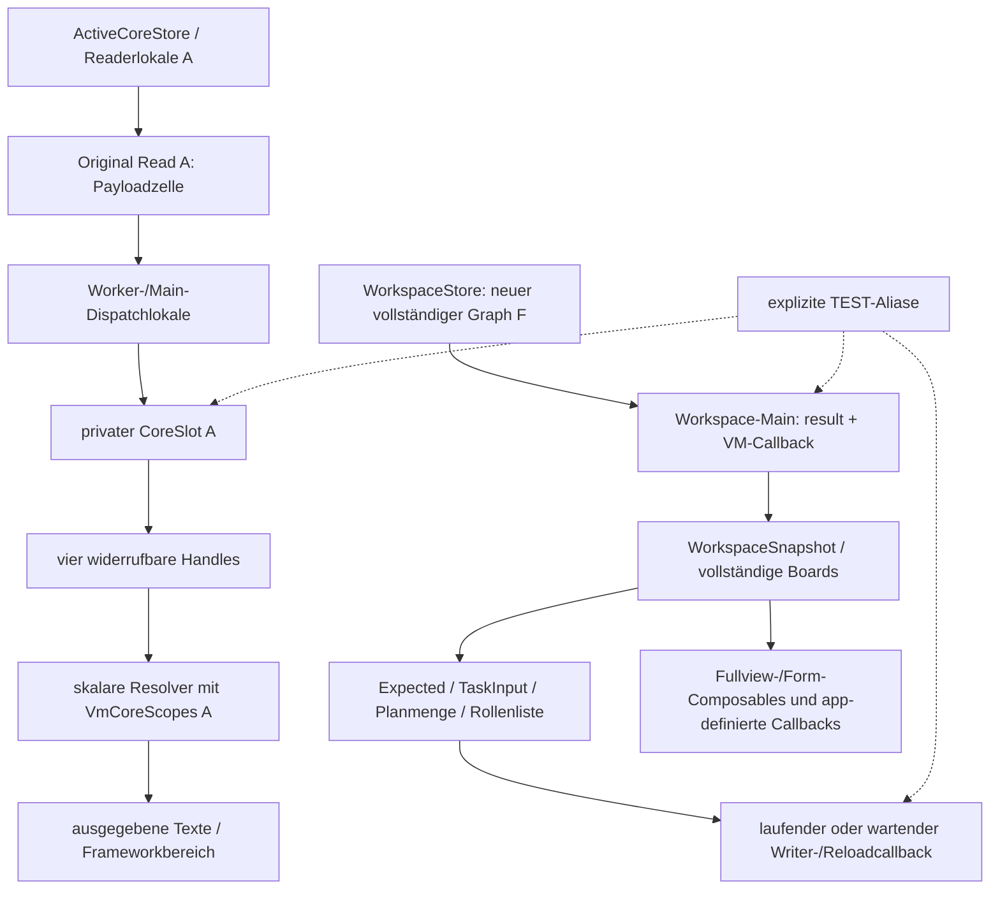

# §105 – Vollständiger Abschlussversuch #37

2026-10-24; Basis `5ec349b581fc549c969ca8041e6de27642319686`, Branch `p11-performance-optimization`.

**BLOCKED. Kein READY_FOR_INDEPENDENT_CLOSURE.** Die kompakte Originalkette besitzt belastbare Teilquittierungen. Der produktive Fullview-/Formularpfad hat dagegen weder einen gemeinsamen Allocation-/Borrow-Vertrag noch eine identitätsgebundene Endquittierung seiner vollständigen DTO- und Callbackgraphen. Deshalb wird **kein globaler Owner-Endreceipt eingeführt** und kein exponierter Read retired. Keine Produktionsänderung in diesem Schritt; drei neue Hostgegenfälle und ein isolierter P77-Runner ergänzen die vorhandenen Belege.

## Konkretes Ergebnis und kleinster Restvertrag

Der fehlende Vertrag lautet:

> **Jede Fullview-/Formularmaterialisierung und jeder damit verbundene laufende Zugriff muss vor der Aufnahme seiner Datenreferenz beim ursprünglichen Workspace-Owner zugelassen und gebucht sein; nach synchronem Autoritätswiderruf müssen sämtliche zu dieser Originalidentität gehörenden app-eigenen Übergaben, Zugriffe und gehaltenen Repräsentationen ihre tatsächlichen Enden quittieren können.**

Heute fehlen genau diese Anschlüsse an drei zusammenhängenden Grenzen:

1. `ProductViewModel.useFullActiveView → readWorkspace → ProductWorkspaceRepository → WorkspaceStore`: `fullViewStarting()` setzt eine Sperre für **spätere kompakte** Reads. Es verweigert den folgenden Fullview-Read nicht und liefert keine Budgetzulassung für ihn. `WorkspaceStore` ruft `OperationsStore.board` und ggf. `TaskStore.board` auf. Diese materialisieren vollständige Listen, ohne die gemeinsame Core-Admission zu verwenden. `WorkspaceRead/WorkspaceSnapshot` tragen keinen entsprechenden Reservation-/Endreceipt.
2. `ProductWorkspaceRepository.main.execute { …publish(result)… }` und der echte `readWorkspace`-Callback: Runnable-Felder halten das Ergebnis; Callback-`ObjectRef`s halten u.a. `ops` und `taskBoard` auch nach Publication. Cancellation/Request-/Generationgates verhindern einen späten UI-Patch, quittieren aber nicht die Rückgabe sämtlicher Datenreferenzen. Das ist nicht die in §99 entkoppelte **Core**-MainHandoff-Shell.
3. `TaskModel`/`OperationsModel`/Personen-/Rollen-/Planformulare: Expected-Modelle, Entwürfe, Planmengen/-katalogreferenzen sowie bereits gestartete Writer-/Reload-/UI-Callbacks haben eigene Halter. Schema-12-Revisionen verhindern Lost Updates, sind jedoch **keine** Speicher-Lifetime-Tickets. CoreSlot-Scopes zählen diese Zugriffe nicht; Clear einer Modelvariable beendet keine bereits gestartete Übergabe.

Das sind keine drei neuen Owner oder drei unabhängige Budgets. Es fehlt der Anschluss dieser bestehenden Pfade an **denselben** kontrollierten Ownervertrag. Ein lokaler Boolean nach VM-Clear oder ein weiterer Dispose-/Framecallback kann ihn nicht ersetzen. Auch ein unveränderliches `CoreSlot.value` ist für sich allein kein Unmöglichkeitsbeweis: Entscheidend sind tatsächlich verbleibende Referenzkanten und fehlende Quittierungen.

## Tatsächlicher Referenzgraph

**Kein direkter produktiver Core→Fullview-Kopierpfad wird behauptet.** Fullview liest einen neuen, unabhängigen Datenbestand aus derselben autorisierten DB. Gerade deshalb muss seine Materialisierung mit noch gebuchten alten Verpflichtungen zusammen zugelassen werden. Gleiche fachliche Personen/Tasks bedeuten nicht dieselben Objektidentitäten; zwei Verweise auf dasselbe DTO sind wiederum nicht automatisch zwei Payloadkopien. Beides wird nicht pauschal als null gebucht.

### Referenzaufnahme, Revoke und tatsächliches Ende

| App-kontrollierte Stelle | Aufnahme / Originalbindung | Revoke und tatsächlicher Abschluss | Einstufung |
|---|---|---|---|
| Reader-/Builderlokale | nach gemeinsamer R8/T16-Admission, Originalticket A / Action / Generation / Mutation | tatsächliche Rückkehr `readForTicket/readCandidate`; DB-/Coroutine-/Keycleanup und Worker-finally separat erforderlich | **CONFIRMED** bestehende benannte Teilkette; während laufendem Reader **BLOCKED** |
| `Read.payload` | eine Originalzelle A | atomare Entnahme/Leerung; kein Ende der weitergereichten Lokalen | **CONFIRMED** Zellenkante, kein globales Ende |
| Worker-/Main-Shells | ursprüngliches Read bis erster tatsächlicher Entnahme | §99: Shell verliert `read`; laufender Dispatcher behält Original bis endlich/finally/ACK | **CONFIRMED**; verlorener/noch nicht quittierter Dispatch **BLOCKED** |
| Loader-Callback / Installation | Result A, Original-Lifetime und privater Slot A | Original-Main-ACK erst nach Callbackrückkehr; Installation eigener VM-Scope | **CONFIRMED** Teilquittierungen; kein beliebiger Callbackretention-Endbeweis |
| privater CoreSlot / vier Handles | nur im vorhandenen VM; Handles halten Identität + widerrufbaren Ownerlink | synchrones Detach, alle Ownerlinks widerrufen; laufende Resolver/Invalidator-/Installationsscopes zählen weiter | **CONFIRMED** Autoritäts-/lokaler Scopevertrag |
| Lifetime-/Invalidation-Subscriptions | Originalticket/Lifetime, VM-/Identitätsmetadaten; kein weiterer Payloadcache | Close/Cancel trennt Listener; laufender Callback muss wirklich zurückkehren | **CONFIRMED** getestete Kanten; bloßes Cancel kein globales Ende |
| Skalare bereits ausgegebene Werte | beim gültigen Resolverabruf | späterer Abruf gesperrt; alter Text wird nicht rückrufbar | **OUT OF SCOPE** Frameworkhaltung; app-eigene laufende Resolver bleiben bis Rückkehr gezählt |
| `WorkspaceStore`-/Fullview-Readerlokale | neuer Graph F im Original-Session-/DB-Scope; Actionstatus/Generation/Requestticket | DB-/Keycleanup vor Publication, aber keine gemeinsame Core-/Formreservation oder DTO-Endquittierung | **BLOCKED** Integration |
| Fullview-Main / VM-`readWorkspace`-Callback | `WorkspaceResult.Value`, `ops/people/taskBoard`-Refs und Callback; Request/Action/Generation | Requestcancel und zentrales Publicationgate sperren Veröffentlichung; Datenfelder werden dadurch nicht identitätsgebunden geleert/quittiert | **BLOCKED**, konkret per Host/Android reproduziert |
| `WorkspaceSnapshot`, vorige/neue Workspaces | Publication in VM; `previous` und gestagte neue Ergebnisse können während Refresh gleichzeitig existieren | `clearPersons` leert aktuelle Felder und verwirft Requests. Keine quittierte gemeinsame Alt-/Neu-/Formarena | **BLOCKED** Buchung/Lifetime; Clear-Sicherheitssemantik erhalten |
| Taskeditor | `selected`, unveränderliches `editorExpected` samt S12-Revision; `TaskInput`-Entwurf | Cancel/Lock/Action-/Generationwechsel entkoppeln Modelzustand. Schon gestarteter Writer hält Expected/Draft bis zu seinem wirklichen Ende | **BLOCKED** Owner-End/Buchung; CAS-/Authorityvertrag **PASS** |
| Personen-/Rollen-/Plan-/Live-Editor | `editingPerson`, Role-Expected, eingefrorene Plan-ID-Menge/Headerrevision, `planRoles`, OperationalState-Expected, Entwurfstexte | bestehendes Clear/Cancel/Originalgeneration/DB-CAS; keine gemeinsamen Borrow-/Allocationreceipts für alle Halter | **BLOCKED** globaler Ownervertrag; §104-Konfliktvertrag bleibt **PASS** |
| app-definierte Fullview-/Formcallbacks | vollständige Modelle/ausgewählte Zeilen bzw. Model-/Stateverbindungen an die UI | entfernte Node/Composition-Dispose ist kein Endreceipt ihrer app-eigenen Captures | **BLOCKED** app-eigener Lendingvertrag; echte Frameworkkopien separat |
| Lock/Reauth/Actionwechsel | ursprüngliche Session-/Ticket-/Requestidentitäten | synchroner Autoritätswiderruf; alte Main-/Writeraufrufe dürfen nicht wieder publizieren. Neue Generation ist keine Speicherendquittierung | **PASS** getestete Gates; globales Ende **BLOCKED** |
| Activity-/Runtimewechsel | `MainActivity` konstruiert Runtime und VM; `onDestroy` schließt Runtime und ruft `shutdownNow` | weder `shutdownNow` noch neue VM-Konstruktion ist ein vollständiger End-/Budgetübernahmereceipt. Kein Recreate-Reset als Alternative zugelassen | **BLOCKED** für globale Lebensdauerannahme; kein neuer Recreate-Geräteversuch behauptet |
| gezielt gehaltenes altes Slot-/Read-/DTOobjekt | ausschließlich ausdrücklich benannter TEST-Alias | Testalias kann nach lokalen ACKs weiter existieren; keine neue produktive Registry | **BLOCKED solange Testalias lebt**; kein Beweis eines normalen Produktleaks |

Die app-eigenen Rückgabepfade der vier kompakten Composables enthalten weiterhin nur die vorhandenen Handles. Es wird kein neuer produktiver Getter eingeführt. Fullview-Composables erhalten dagegen weiterhin komplette `OperationalBoard`-/`TaskBoard`-Modelle; deren app-eigene Captures dürfen nicht allein durch das Wort „Compose“ dem ausgenommenen Frameworkbereich zugeschlagen werden.

## Gegenproben mit echtem Produktpfad

### Neue Hostgegenfälle und bestehende gezielte Regressionen

[Hostlauf](host-02.log), [Bilanz](host-summary.json), XML `host-app-xml/`, `host-data-xml/`: **55 App + 35 Data = 90 Fälle, 0 Fehler/Skips**. Ein anschließender [gezielter Publicationsfall](host-publication-04.log) ergänzt eine weitere, neue Gegenprobe (XML `host-publication-xml/`): insgesamt91 verschiedene Fälle.

- Neu `ActiveWorkspaceTest.p105CombinedWorkspaceCallbackRetainsOwnBoardAfterPublicationAndLock`: echter VM-`readWorkspace`-Callback mit Combined-Repository-Port; sein `ObjectRef` hält das volle Board nach Rückkehr und Lock, während `model.workspace==null` ist. Später Callback publiziert nicht. Der gehaltene Callback ist ausdrücklich ein TEST-Alias; Port/Session sind Hostadapter, keine Androidautorität.
- Neu `p105Schema12TaskExpectedAndDraftClearDoesNotInvalidateAnActiveCallersAlias`: Revision7/Entwurf vor Lock erfasst; Felder sind danach leer, die absichtlich gehaltenen Testlokalen bleiben lesbar. Kein physischer Wipe-/globaler Endnachweis daraus.
- Neu `ActiveCoreOwnerTest.p105FullviewNavigationDuringOriginalPublicationCannotEndTheInstallingScope`: Fullview-Navigation direkt während der originalen Slotinstallation. Slot ist entkoppelt, aber die noch laufende Installationsscope bleibt NOT_QUIESCENT; erst tatsächliche Callbackrückkehr beendet sie. Host-Lifetimeadapter, kein globaler Android-Endbeweis.
- `ActiveCoreOwnerTest`: alle vier Handles, Originalslotidentitäten, Revoke zwischen skalaren Abrufen, VM-Resolver/Installation/Invalidator während Revoke, Exceptions, fremde Threads, A/B-Identitäten, späte Mainantworten, Fullview-Rückkehr, verlorene Callbacks, Quieszenzdiagnose und verweigerte zweite Admission. Dort vorhandene Wiederverwendungserfolge verwenden einen ausdrücklich **fiktiven Hostport**, keine Produktfreigabe.
- `P97CoreReferenceLifetimeTest`, `OutstandingCoreReadTest`: Workerabbruch vor Materialisierung, materialisierter Kandidat vor Main, verlorener Main ohne ACK, tatsächlich verworfener Main mit ACK, Cancellation während Worker, bestätigtes/unbestätigtes Cleanup, ursprünglicher expliziter Read-Testalias und Shellentkopplung. Unterminierte Teilketten bleiben zu Recht gebucht.
- `CoreReadAdmissionBudgetTest`: exakte gemeinsame R8/T16-Grenzen und +1, alte/neue/Builder-/Form-/Handlekosten, Overflow und Refusal vor Materialisierung. Diese Tests lassen **keine ungebuchte produktive Fullviewkopie** nachträglich als abgedeckt gelten.

### P77, echte Runtime/Room/SQLCipher/Compose

Runner: `P105OwnerClosureProbe`; vorhandene Isolation/Signerprüfung in [run-device.py](run-device.py). Kein neues Activity-/Runtime-/Key-/Sessionprodukt. Bestehende `P86FullWorkspaceActivity` wird im Test ausdrücklich mit dem **echten produktiven Compact-Port** verbunden; ohne diesen Testanschluss bleibt ihr historischer Fullview-only-Testzweck getrennt.

| Beleg | Tatsächlich geprüft | Ergebnis |
|---|---|---|
| [small02](device-small-02.txt) | sichtbarer erster HUB, 20 Personen/40 Tasks; Navigation nach PERSONS bei reuse=false verweigert. Originalslot per ausdrücklich markiertem TEST-Alias gehalten, lokale VM-Quieszenz nach Detach, Originaldaten weiterhin lesbar; Outstanding bleibt geschlossen | **PASS** Gegenbeweis, globaler Owner-End **BLOCKED** |
| [large02](device-large-02.txt) | gleiche Originalkette mit 200 Personen, 1.000 Tasks, 32 Rollen und 5.000 Events einschließlich langer Unicode-Texte; Fixture prüft COUNT5.000 vor Runtimebeginn | **PASS** Gegenbeweis und große kompakte Zulassung; keine 100-Rollen-Produktfreigabe |
| beide P105-Fälle | bestehender `useFullActiveView()`-Pfad hält den tatsächlichen Workspace-Main vor Ausführung; nach seiner wirklichen Rückkehr ist sein Board erreichbar. Vollständiges produktives Workspace enthält tatsächlich20/200 Personen und40/1.000 Tasks | **BLOCKED** gemeinsame Admission/Endquittierung, nicht bloß vermutetes Risiko |
| beide P105-Fälle | tatsächlich sichtbarer Taskformularentwurf; ändern, abbrechen, erneut öffnen erhält ursprünglichen gespeicherten Wert. Neuer Save hält originalen Writerworker an; nach Lock sind VM-/Editorfelder leer, tatsächlicher wartender Worker hält denselben Expected-Task weiter. Worker danach ausführen; nach Reauth DB-Zeile samt Revision unverändert | **PASS** Autoritäts-/Formgegenprobe; vollständiger Owner-End/Buchung **BLOCKED** |
| beide P105-Fälle | alter Workspace-Main nach Lock doppelt aufgerufen, kein Restore; Reauth mit anschließendem originalen `loadOwned` weiterhin DENIED, Readcount1. Alter Core und neuer Workspace/Formgraph werden absichtlich gleichzeitig als TEST-Aliase gehalten | **PASS** Fail-closed, keine Readmissionfreigabe |
| [vier Routen](device-four-routes.txt), bestehender `P96CoreSurfaceProbe` | HUB/PERSONS/TASKS/FUNCTIONS tatsächlich sichtbar; je ursprünglichem Testowner ein Read, Originalticket-Pending/UNKNOWN widerruft alte Handles, doppelte alte Mainantworten und zweite Admission abgewiesen | **PASS** vier getrennte synthetische Fixtures, **kein** erfolgreicher produktiver Navigationszyklus nach Exposition |

Zwei P105-Szenarien wurden zuerst ohne zusätzliche Originalslot-Testretention ausgeführt ([small01](device-small-01.txt), [large01](device-large-01.txt)); danach um explizite Originalslot-/Value-Retention, lokale Quieszenz und sichtbaren Formulartext erweitert und erneut grün ausgeführt. Keine fehlgeschlagenen §105-Geräteläufe. [Build/erste Hostgegenfälle](build-host-01.log), [abschließender Runnerbuild](build-device-03.log) erfolgreich. Benannte Kotlin-Warnung zum Parametername im Hostadapter ist kein Testfehler.

Wiederverwendete, passende reale Gegenbelege statt neuer Writer-/SQL-Cleanup-Audits:

- [§100 lock/cancel](../p11-p100/assessment.md): laufender PEOPLE_ROW mit Cursor/Lease gehalten, synchroner Lock bzw. echte Cancellation; kein zweiter Core während laufender Arbeit, tatsächliches Worker-/DB-/Keyende erforderlich. Keine Gleichsetzung mit physischem Native-Ende.
- [§102](../p11-p102/assessment.md): terminal UNKNOWN, reale externe P3b-Keyeffekte und ausdrücklich frisch autorisierte Recovery; Recovery und bestätigter Commit/Cleanup sind keine Payload-Endreceipts.
- [§104](../p11-p104/assessment.md): Schema12-CAS/ABA, Lost Publication/Commit-vor-Lock und sichtbare Person-/Rollen-/Plan-/Task-/Live-Konfliktentwürfe/Reloads. Diese produktiven Verträge wurden in §105 nicht verändert.

Das UNKNOWN im P96-Fall ist ein ausdrücklich gesetzter Protokoll-Metadatengegenfall, kein nachgewiesener SQLCipher-/Vendor-Cleanupfehler.

Keine breite Androidsuite und kein Performancebenchmark. Keine echte DeviceCredential-Authentisierung behauptet: P77 bleibt synthetisch. Fixturebereinigung bestätigt, keine synthetischen P3b-Aliase in den neuen Fällen angelegt; kein Produktalias angefasst. [APK-/Signernachweise](resume-apks.json), [Cleanup](resume-cleanup.json), geschützte Vorher-/Nachher-Paketinventare im selben Verzeichnis. Ausschließlich P77-Ziel- und Testpaket installiert, kein `pm clear`.

## R8/T16: entscheidender Unterschied zwischen gebuchtem und ungeprüftem Pfad

Grenzen unverändert **R8=8.388.608 / T16=16.777.216 Bytes**. Im neuesten großen Originalread: lokale Rechnung R=2.551.127/T=10.647.432; der exklusive Outstanding-Owner hält weiterhin **die gesamte T16-Hülle**, `retirementConfirmed=false`. Der kleine Originalread rechnet R=1.547.555/T=6.266.096. Das sind Ledger-Engineeringkosten, keine gemessenen ART-/Native-/PSS-Obergrenzen. Kleine Unterschiede zwischen Läufen entstehen durch die ausgewählten synthetischen UUID-/Titel-Seiten; kein neuer exakter Produkt-Maximalwert wird daraus abgeleitet.

`retained=0` nach Revoke bedeutet hier nur `retainedReserved=false`; es ist **kein** Beweis verschwundener alter Daten. Die alte Übergangsverpflichtung besteht weiter. Der produktive Fullview-Read erhält daneben derzeit überhaupt keinen gemeinsamen Receipt. Weder seine alten/neuen Boards noch Form-Expected-/Input-/Plan-/Callbackkosten dürfen in einer Globalrechnung als null eingesetzt werden. Die Tests beweisen **fehlende Vorabzulassung**, nicht eine konkret gemessene Überschreitung um X Bytes.

**Präzisierung zu §104:** Die dort dokumentierte konservative große Fullview-Verweigerung ist die von `BoundedActiveStore` im Reader-Gegentest. Sie ist **keine** Verweigerung von `ProductWorkspaceRepository.WorkspaceStore`. Der neue echte Produktpfad liefert das vollständige große Board tatsächlich aus. Diese beiden Pfade dürfen nicht als derselbe Budgetnachweis behandelt werden. §104s CAS-/Migrationsbelege werden dadurch nicht aufgehoben; eine allgemeine Fullview-/Form-RAMfreigabe ergibt sich daraus nicht.

Framework-/Compose-/Textlayout-/IME-/Accessibility-/Render-/SQLCipher-/Native-Ressourcen bleiben separat #33/#39, weder kostenfrei noch physisch vollständig freigegeben. Es wird kein künstliches OOM ausgelöst und keine Gesamt-OOM-Grenze behauptet. Der historische Refusaltext `COMPOSE_OR_FRAME_UNCONFIRMED` und die Phase `COMPOSE_TRANSITION` sind kein Auftrag für einen weiteren Framecallback: Das hier nachgewiesene Hindernis liegt bereits in den app-eigenen Fullview-/Formreferenzen und deren gemeinsamer Buchung.

## Vollständige ursprüngliche #37-Akzeptanzmatrix

Die historische 8+8-Formulierung im Issue wird ausschließlich entsprechend der verbindlichen §91-Entscheidung als R8/T16/Option2 geprüft.

| Ursprüngliches Kriterium | Produktpfad / Vertrag | Test / Rohbeleg | Entscheidung |
|---|---|---|---|
| navigateActive / clearPersons / readWorkspace / WorkspaceSnapshot / Requests / Formlebensdauer abgleichen | Clear beendet Authority/Requests und löst aktuelle Modelverbindungen; Fullview-/Form-/Callback-Enden sind nicht damit quittiert | neue Hostfälle, P105 small/large; Referenztabelle | **BLOCKED** vollständige Ownerintegration; Clear-Gates **PASS** |
| genau eine ACTIVE-Aktion mit Action/Status/READY/Permission/Mutation/Load/Originaltickets | kompakter Slot/Lifetime/Originalticket identitätsgebunden. Workspace-/Formobjekte haben eigene Session-/Request-/CAS-Gates, aber keine gemeinsame Allocation-/Endidentität | ActiveCoreOwnerTest, P96, P105, unveränderte §104-Gates | **PASS** kompakter Authorityvertrag; **BLOCKED** ganzheitlicher Owner |
| nur zugelassener kompakter Kern, keine geschützten Nebenroots | CoreStore plus vier skalare Handles, kein produktiver Core-Borrowgetter | Sourceinventar §§92–96, Host-NoBorrow, vier sichtbare P96-Routen | **PASS** kompakter Umfang; Fullview-/Formbereiche nicht als kompakter Kern zugelassen |
| eine gemeinsame R8/T16-Buchhaltung inklusive alter/neuer/Formzustände und kontrollierter Refusals | CoreAdmission und exklusiver Read sind korrekt; produktiver Fullview-/Formpfad passiert keine gemeinsame Admission | Budgettests, reale Outstandingwerte und trotzdem materialisierte große Fullview-Boards | **BLOCKED**; Core-only-Refusals **PASS** |
| synchron Invalidate/Unpublish bei Lock/Foreground/Fristen/Generation/Action/Status/Permission/BLOCKED/Maintenance/Recovery ohne späte Publication | Originalsession und Writer-/Requestgates bleiben maßgeblich. Revoke entfernt Handles synchron; späte Publikation verweigert; Fristen unverändert | Owner-/P97-/Outstanding-Hostfälle, P105/P96, passende §100/§102/§104-Belege | **PASS** benannte Autoritätsgates; kein globaler Datenendbeweis daraus |
| jeder RAM-Hit über Acquire/check/publish, keine künstliche Sessionverlängerung | `ProductActiveCoreLifetime.authorizeHit` und Resolver vor/nach Publication; keine aktiven Produktreusehits | Owner-Hostfälle und Original-Lifetimequellen; P96 Revoke/UNKNOWN | **PASS** Prüfvertrag; Aktivierung weiterhin gesperrt |
| Formwerte/Fokus/geschützte Bereiche bei Navigation und alte Referenzen korrekt behandeln | §104 Draft/CAS/Reload/Warnung bleibt bestehen; Clear sperrt aktuelle Form, wartende Worker/Fullviewcallbacks halten alte Daten bis tatsächlichem Ende | §104 sichtbare Konflikt-/Reauthfälle, P105 sichtbarer Entwurf/Cancel/Reopen/Lock und tatsächlicher Worker-Capture | **PASS** benannte UX/Authority; **BLOCKED** vollständige app-eigene Ref-/Budgetintegration; kein Frameworkwipe |
| Host-/Androidregressionen inklusive Reauth/Lifecycle/Actionwechsel/Budget/OOM-Verweigerung | konkrete Regressionen bestanden, tatsächlicher Vollpfad nicht gemeinsam budgetiert; kein vollständiger Activity-Recreate-/Native-OOM-Endvertrag | 91 Hostfälle, P105/P96, wiederverwendete explizite Belege; MainActivity-Quellpfad | **BLOCKED** Gesamtabschluss; keine künstliche PASS aus lokalen Tests |
| keine Produktinstallation / Performanceaktivierung separat reviewen | nur isoliertes P77, keine Release-Buildänderung, beide Reuseflags false | Paket-/Signer-/Cleanupinventare; Produktionsdiff leer | **PASS** |

## Sichere Fail-closed-Alternative und überprüfbare Entscheidungsvorlage

Eine eng begrenzte funktionale Alternative ist eine **einmal autorisierte, begrenzte kompakte Leseansicht**, deren skalare Zugriffe und Lock weiterhin funktionieren. Sobald ein Wechsel eine neue Materialisierung erfordert und alte Owner-Verpflichtungen unbestätigt sind, muss sie kontrolliert verweigern. Insbesondere dürfen „Alle anzeigen und bearbeiten“, indirekte Detail-/Form-/Refreshpfade oder ein neuer Runtime-/Sessionzustand die fehlende gemeinsame Admission nicht umgehen. Ein solcher degradierter Pfad bietet keine vollständige ACTIVE-Bearbeitung und ist **kein bereits freigegebener 1.0-Fallback**.

Die existierende kompakte Refusal-Sperre erfüllt einen Teil davon. **Der aktuelle Fullview-Einstieg erfüllt die Alternative noch nicht**: Er wurde hier absichtlich nicht durch eine stillschweigende Produktentscheidung abgeschaltet oder als sicher bezeichnet. Für die Alternative wäre ein ausdrücklicher, durchgängiger Refusal-Gate vor jedem entsprechenden Worker/DB-/Form-Sideeffect notwendig. Die Scope-/Budgetverpflichtung dürfte auch bei Reauth/Recreate nicht durch Neuanlage eines Owners verschwinden.

Für vollständige Bearbeitung ist stattdessen der oben exakt benannte Originalowner-Vertrag zu implementieren: Vorabzulassung des ganzen Fullview-/Formübergangs, kontrollierte Datenausgabe ohne unquittierbare vollständige UI-/Callback-Borrows und tatsächliche Endquittierung aller zugehörigen Worker-/Main-/Form-/Writerzugriffe. Das ist kein neuer Cache und keine neue Sessionautorität. Ein bloßer zusätzlicher Main-Shell-Detach würde nur eine Kante lösen und deshalb #37 **nicht** schließen.

Nachprüfbare Voraussetzung für einen späteren Abschluss: Die vorhandenen P105-Gegenfälle müssen vor Materialisierung kontrolliert verweigern oder einen gültigen gemeinsamen Receipt besitzen; ein angehaltener alter Resolver/Fullviewcallback/Writer hält die Originalidentität weiterhin BLOCKED; erst tatsächlich beendete, vollständig erfasste app-eigene Halter erlauben einen allenfalls diagnostischen Endreceipt. DB-Revision, Commit/UNKNOWN, lokales VM-Quiescent, onDispose/onDraw, GC, WeakReference oder leere Felder dürfen dafür nicht genügen. Produktreuse/automatische Readmission bleiben davon ausdrücklich getrennt gesperrt.

**Jetzt blockiert bleiben:** funktionierende wiederholte kompakte ACTIVE-Navigation nach Exposition, sicher gemeinsam budgetierte Fullview-/Editorübergänge, erneute Core-Zulassung nach Fullview/Lock/Reauth und produktive RAM-Schnellnavigation. #38-Performance und #33/#39-Ressourcen-/Sicherheitsfreigaben sind zusätzlich separat offen. Kein globaler Owner-Endreceipt, keine physische Wipegarantie.

#37 bleibt **BLOCKED / OPEN**. WIP und Belege dienen der unabhängigen Prüfung dieses konkreten Restvertrags. Kein automatischer Folgeauftrag, kein Merge/Release.
