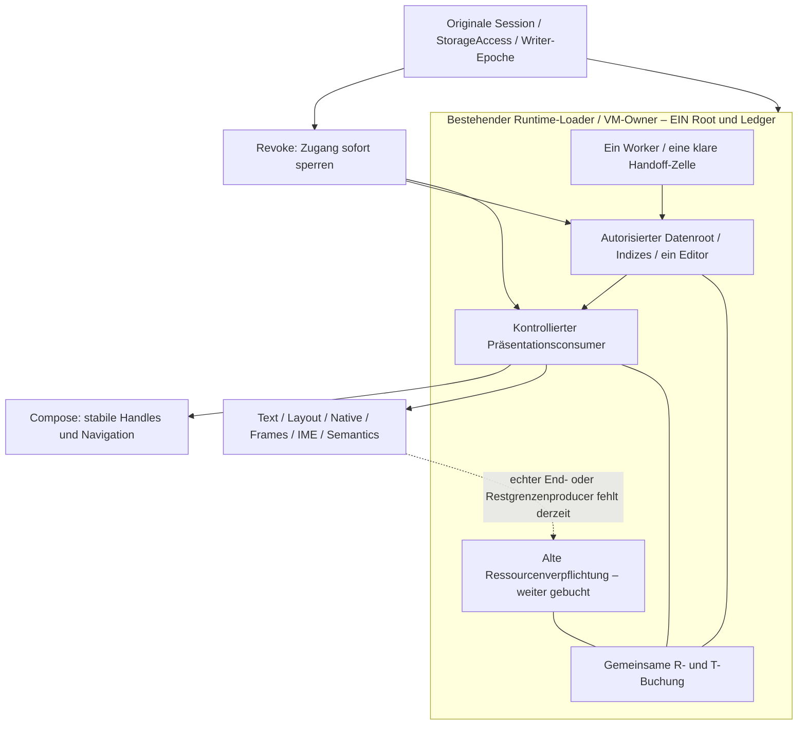

# ADR §89a – Ein Workspaceowner, kontrollierte Präsentation als Voraussetzung

Basis `20adc78e9b79fda9393cd72a2151341b349b4ae5`, Branch
`p11-performance-optimization`; #37/#33/#34/#38, Tracker #44.

**Entscheidung: NO-GO für eine releasefähige Aktivierung mit den derzeitigen
Consumerverträgen.** Variante A unten wird verworfen. **Bevorzugte Richtung ist B**,
aber nur mit vorgeschaltetem, nachweisbarem Präsentationsvertrag; dessen Producer
existiert in der geprüften Integration nicht. Deshalb ist B ein konkreter
Schnittstellen-/Arbeitsauftrag mit Stopgate, keine bereits tragfähige Releasevariante.
Keine Änderung an Sicherheitsgrenzen, kein neuer Lifecycle-Callback als Ersatzbeweis.

## Entscheidungsgrundlage aus §§83–88

| Vorhandener Beleg | Für diese Entscheidung maßgeblich |
|---|---|
| [§83 Referenzmatrix](../p11-p83/reference-matrix.md), [§84 Vertrag](../p11-p84/lifetime-contract.md) | Worker/Main/alter und neuer VM-/Composegraph überlappen. Eine lokale Readercharge ist kein gemeinsames Scopebudget. Der aktuelle Owner reserviert deshalb exklusiv 8 MiB Transition und verweigert weitere Admission. |
| [§85b](../p11-p85b/assessment.md), [§87a](../p11-p87a/assessment.md) | History bleibt separat <=32 Events/Seite. Produktgrenze: 5.000 gespeicherte Events/Aktion; eventlose Task-Edits bleiben erlaubt. Das begrenzt keine Zahl neuer Text-/Layoutversionen. |
| [§86a](../p11-p86a/assessment.md) | `activeCore` gibt rohe Payloadreferenzen heraus. Slot-Clear, Lock und Dispose widerrufen diese Referenzen nicht. Fullview ist ebenfalls nicht retired. |
| [§86b](../p11-p86b/assessment.md) | Vollständige Workspaces umgehen das Problem nicht; alter Maincallback und neuer Workspace sind gleichzeitig lebendig, gemeinsame Admission fehlt. 3,3–5,3 s Navigation sind historische Einzelmessungen mit damaliger 129k-Fixture, **keine neue 5k-Benchmarkserie**. |
| [§88a](../p11-p88a/assessment.md) | Bestehendes reset→close beendet beobachtete Statementcursor/Windows. Das ist kein Ende von Compose-Text, Layout, Renderframes, IME oder deren Kopien; kein pauschaler freier Native-Speicher. |

Budget bedeutet unverändert **8.388.608 B gehalten + 8.388.608 B Übergang**, gemeinsam
für die betreffenden Daten/Präsentations-/Read-/Editorrepräsentationen. Das ist kein
16-MiB-Prozessheaplimit. Die vorhandenen Engineeringgewichte sind keine zertifizierten
ART-/Native-Obergrenzen; unbekannte Kosten werden weder null noch durch eine frei
gewählte „Reserve“ zu einem Beweis. Standardumfang: 200 Personen, 1.000 Tasks,
5.000 Events, 6/32 Rollen. 100 Rollen werden in beiden Vorschlägen kontrolliert
vor Payloadmaterialisierung verweigert, ohne Teil-CONTENT oder Fullreader-Fallback.

## Höchstens zwei Varianten

| Frage | A – Unveränderlicher Kern mit bestehenden Compose-Textconsumern | B – Daten und Präsentationsressourcen unter kontrolliertem Consumervertrag |
|---|---|---|
| **Einziger Owner** | Bestehender Runtime-Loader/Outstanding-Record → ein VM-Slot. Derselbe Kern wird auf allen vier Routen wiederverwendet; keine Screen-Caches. Compose erhält weiterhin Strings/DTOs. | Derselbe Runtime-/VM-Owner besitzt einen Datenroot, die gebuchten Präsentationsressourcen und höchstens einen Übergang. Compose erhält stabile opaque Handles statt fachlicher DTOs/Strings. Kein zusätzlicher Payloadstore neben dem Owner. |
| **8+8 gemeinsam** | Alle noch exponierten Versionen bleiben gebucht. Das ist sicher als Verweigerung umsetzbar, liefert aber nach endlich vielen Versionen keine weitere Admission. Native-/Layoutkosten sind weiterhin nicht begrenzt. **Nicht erfüllt.** | Ein Ledger bucht Daten, Builder, Editor, wartenden Handoff sowie alte/neue Präsentations-/Nativeverpflichtungen vor Allokation. Unbekannte Kosten verweigern Admission. **Erfüllbar nur mit echten Kosten-/Endproduzenten; aktuell nicht nachgewiesen.** |
| **Neu laden trotz alter Referenzen** | Warmnavigation desselben Werts braucht keinen Read. Nach Commit, anderer Seite, Reauth oder Actionwechsel muss ein frischer Wert möglich sein; alte rohe Referenzen können bleiben. Ohne Quotenfreigabe folgt permanente Refusal, mit unbegründeter Freigabe ein Budgetloch. **Nicht erfüllt.** | Alte Handles gewähren keinen Datenzugriff. Eine alte Daten-/Präsentationsversion darf nur nach tatsächlich belegtem Consumerende oder belegter begrenzter Restbelegung Platz freigeben. Ein vorhandenes altes Handle ist allein kein Hindernis; eine unbestätigte alte Ressource bleibt eines. **Derzeit fehlt dieser Producer.** |
| **Lock/Reauth/Writer/Permissions/Callbacks** | Zentraler Revoke kann Autorität synchron entziehen, aber keine vorher ausgehändigten Werte zurückholen. Originale Fences erhalten Sicherheit durch Refusal; normale Wiederaufnahme bleibt ungelöst. | Originale Session/Writer-Epoche und identitätsgebundener Revoke bleiben maßgeblich; genaue Zustandsregeln unten. Autoritätsende und Ressourcenende bleiben getrennt. |
| **100–150 ms** | Ein autorisierter RAM-Hit auf denselben Kern könnte SQL-freie Routenwechsel ermöglichen. Das löst den Austausch-/Editor-/Reauthfall nicht; keine Freigabe allein wegen guter Warmmessung. | Einmal autorisierte, gebuchte Hub-/People-/Functions-/Task-Übersichten werden aus demselben Root präsentiert, mit begrenzten Viewports. Routenwechsel prüft zentrale Autorität und schaltet Handles um, ohne DB-Open. Renderkosten und Median/p95 sind anschließend real nachzuweisen. |

**Exakt unvereinbar bei A:** (i) fortgesetztes frisches Laden nach gewöhnlichen
Writes/Reauth/Actionwechseln, (ii) endliches gemeinsames 8+8-Budget und (iii) weiterhin
erlaubte, unbefristet unkontrollierte Aufbewahrung exponierter Daten/Kopien außerhalb
des Owners ohne belegte Restgrenze. Alle drei sind zusammen nicht durchsetzbar.
Man kann jede ungeklärte Altversion weiter belasten und irgendwann verweigern oder
deren Buchung ohne Nachweis löschen; beides erfüllt nicht alle Anforderungen.
Schon eventlose Titeländerungen erlauben mehr Versionen als die 5k-Eventgrenze.
Das ist **kein** Beweis, dass Compose tatsächlich alle Versionen unbegrenzt hält;
es ist der Gegenfall, den der aktuelle ausleihende API-Vertrag nicht ausschließt.

**Exakter Stopper bei B:** Der neue Consumervertrag darf nicht nur behauptet werden.
Aktuell gibt es weder einen Producer für das vollständige Ende der von ihm an
Compose/Text/Layout/Render/Editor/IME/Semantics weitergegebenen Daten noch eine
belegte gemeinsame Rest-/Maximalbelegung. Ein opaque Handle oder ein Callbackname
stellt diesen Producer nicht her. Solange die Darstellung darunter wieder rohe
Strings unkontrolliert weitergibt, hat B denselben Widerspruch wie A. Kein GO.

## Referenz- und Lebensdauervertrag für die bevorzugte Richtung B

**Buchungsregel:** R enthält aktuellen Datenroot, Indizes, aktive Darstellung und
Drafts; T enthält genau einen vorbereiteten Wechsel einschließlich Read-/Dekodier-
temporaries, wartender Payload und aller noch nicht beendeten Altverpflichtungen.
Jede Allokation wird einmal vorab zugeordnet, auch Layout-/Render-/Handlekopien.
Ein Kandidat ist vor Installation nur in der vorhandenen Handoff-Zelle; ein
verlorener/ungeklärter Main-Handoff blockiert weitere Admission. Keine Payloadqueue.

Promotion ist ein atomarer **Buchungswechsel**, kein Retirement: Neuer Root darf
R erst übernehmen, wenn die weiter lebenden alten Kosten zusätzlich in T passen.
Mit ungeklärter alter Übergangsrepräsentation wird kein dritter Graph begonnen.
Beide Grenzen müssen vor, während und nach dem Wechsel gelten. Enden aller
Producer, Worker/Main und DB/Keyscopes oder eine tatsächlich bewiesene Restgrenze
bestimmen die Freigabe. Bei unbekannter Render-/Nativecharge wird nicht gelesen.
Der gesamte pauschale §84-Transition-Fence darf vorher nicht verkleinert werden.
Das Ledger bleibt am ursprünglichen Ownerthread. Worker erhalten nur gebuchte,
unveränderliche Reservierungsmetadaten, kein zweites Ledger. Der SQL-Metadatenplan
wird unter der vorab reservierten Transitionhülle ermittelt und vor Payload über
denselben identitätsgebundenen Handoff vom Owner zugelassen. Warten auf diese
Quittung verlängert keine Session/Keylease; Revoke und unbekannte Queueannahme
bleiben blockierende bzw. cleanup-pflichtige Zustände.

**Laden/Navigieren:** Initial nur den gemeinsam zugelassenen kompakten Root samt
erreichbaren Übersichtsdaten/aktuellen Viewports materialisieren; exakte globale
Zahlen und Cursor erhalten Zugriff auf alle 200/1.000 Datensätze. Pro Liste begrenzte
Karten, keine 1.000 Compose-Zeilen oder pro Screen neu gebauten Vollboards. History
bleibt explizite 32er-Seite. Nachladen neuer Seiten/Details ist ein eigener gebuchter
Read, keine als schneller RAM-Hit deklarierte DB-Operation. Zurück zur noch gültigen
gebuchten Übersicht benötigt keinen SQL-Open. Ein nach Write/Actionwechsel neu zu
autorisierender Root hat keinen garantierten 150-ms-Ladepfad.

| Ereignis | Verbindliche Regel für B, keine neue Autorität |
|---|---|
| Warmnavigation | Bestehendes `authorizeHit`-Prinzip: frisches READY-acquire/check/publish plus aktuelles Action-/Status-/Generation-/Epoch-/Loadbinding. Kein Slot-Boolean als Freigabe, kein zusätzlicher Keyscope und kein Preflight pro RAM-Hit. Normale Reads behalten alle Preflights. |
| Lock, Frist, Foregroundverlust, Permission-Revoke | Zugang im Originalowner synchron sperren, ausstehende Publikationen fencen. Consumer muss weitere Auflösung verweigern. Speicherbuchung bleibt bis Ressourcenende bestehen; bereits kopierte Texte sind dadurch nicht rückwirkend gelöscht. |
| Reauth / Actionwechsel | Neues Originalbinding, keine Wiederverwendung alter Grants, keine zweite aktive Aktion. Altlasten bleiben im selben Ledger; bei fehlendem Platz oder Endnachweis Refusal. VM-/Runtime-Neuanlage ist kein Budgetreset; Verpflichtungen müssen vor Ersatz beendet oder im selben Owner weitergetragen werden. |
| Writer Pending / COMMITTED | Vor Queue bestehende Writer-Epoche invalidieren und Read/Hits fencen. Erst bestätigter Commit **und** Cleanup sowie ein neu autorisierter gebuchter Read liefern frische Daten. Kein optimistischer Copy-on-write ohne Charge. |
| ROLLED_BACK / UNKNOWN | Nur bestätigter Rollback mit Cleanup erlaubt die bestehende Abschlusssemantik. UNKNOWN/Recovery bleibt fail-closed; kein Replay eines alten Roots als „aktueller“ Zustand und kein Buchungsreset. Fehlende Writerhooks (#35) bleiben Aktivierungsblocker. |
| Verspätetes/dupliziertes Main oder Endsignal | Originale Load-/Scope-/Ressourcenidentität, Generation und Epoche prüfen, bestehendes One-shot-Handoff erhalten. Nur die quittierte Zelle beenden; kein altes Signal darf einen neuen Slot oder dessen Quoten freigeben. |

## Konkrete Schnittstellenänderungen – erst nach dem Producer-Gate

- `ProductViewModel.activeCore: ActiveCorePayload?` und die rohe DTO-Weitergabe aus
  `ActiveWorkspace/CompactActiveContent` durch eine ausschließlich ownergebundene
  `PresentationHandle`-Sicht ersetzen. Kein `withText { String -> ... }`: Auch ein
  Unit-Callback kann Strings behalten. Handles/Darstellungsrevisionen brauchen selbst
  eine begrenzte Allokations-/Lebensdauer, nicht beliebig neue Wegwerfobjekte.
- `ActiveCoreLoadPort` um `prepareViewport(binding, area, cursor, plan)` und
  `admitPresentation(plan)` konkretisieren; der bestehende Loader bleibt Producer
  und alleiniger Worker-/Handoff-Owner. `UNKNOWN_COST`/fehlender Consumervertrag ist
  eine typisierte Refusal vor Materialisierung, niemals EMPTY/Partial-CONTENT.
- `OutstandingCoreRead` und `ActiveWorkspaceBudget` zu **einer** Ownerbuchung über
  Read, Darstellung, Detail/Fullview und Editor verbinden. `CoreReadAdmission`
  liefert geprüfte Komponentenpläne in diese Buchung; keine neue Reader-Ledgerkette.
  Das ist eine spätere Vertragsänderung, keine heutige Gatefreigabe.
- Consumer liefert identitätsgebundene `ResourceEndEvidence` oder einen geprüften
  `ResidualBound` ausschließlich aus tatsächlich benannten Ressourcenoperationen.
  Keine öffentliche `presentationEnded(true)`-Methode für Composables. Ein Plan muss
  alle Text-/Layout-/Native-/IME-/Accessibilityconsumers inventarisieren und dessen
  Obergrenzen/Endproducer belegen. Für den aktuellen Backendpfad fehlt dieser Plan.
  `onDispose`, `onDraw`, GC, WeakReferences und Slot-Leerung liefern diesen Beleg nicht.
- `fullViewStarting()` nicht durch „Back setzt false“ ersetzen: Detail-/Editorversuch
  erhält im selben Owner eine Identität und Charge. `TaskModel.input/selected` und
  Personen-/Operationseditoren sind Kinder desselben Roots bzw. der einen gebuchten
  Übergangsrepräsentation; kein zweites unbudgetiertes WorkspaceSnapshot. Bestehende
  CAS-/Permission-/Writerverträge bleiben maßgeblich, ABA (#36) wird nicht wegdefiniert.

## Kleine Aufträge und Abnahmereihenfolge

1. **Zuerst ausschließlich Consumer-Producer-Vertrag (#37/#33).** Für einen konkret
   benannten Darstellungsbackendpfad alle geschützten Text-/Layout-/Frame-/Editor-
   /Semanticsübergaben benennen; je Ressource harte Begrenzung oder reales Endsignal
   samt Quelle vorlegen. Native-/Allocatorrest separat. Nur beobachtete Maxima reichen
   nicht. **Fehlt ein Producer, STOPP; kein zweiter Slot, kein Gate-Reset, kein Reuse.**
2. **Nur bei bestandenem 1:** Die rohe Borrow-API durch begrenzte Handles ersetzen,
   noch keine Cacheaktivierung. Host-Gegentest hält alte Handles nach Revoke und
   versucht String-/Payloadescape, alte Generation, Editorwechsel und VM-Ersatz.
3. **Ein gemeinsamer Admission-/Handoff-Slice (#34):** Vor Queue/SQL/Key reservieren,
   R/T-Übergänge und vollständige Refusals testen. Exakte Grenze/Byte darüber,
   Alt+Neu+wartend+Editor+Renderreserve, verlorenes Main, Cleanup-UNKNOWN und veralteter
   Endbeleg; maximal eine Übergangsrepräsentation. Keine unbekannte Charge als null.
4. **Writer-/Securityintegration vor Reuse:** Je ein fokussierter Fall für Commit,
   Rollback, UNKNOWN/Recovery, Permission-/Session-Revoke, Reauth und Actionwechsel.
   Keine SQLCipher-Connection/Keylease für Warmnavigation offen halten.
5. **Erst dann #38/P77:** 200/1.000/5.000 mit 6 und 32 Rollen; 100 Rollen Refusal
   vor Payload. Hub→Personen→Funktionen→Tasks→zurück nach initialer Autorisierung:
   echte Touch→committed Content-OnDraw-Median/p95 pro Route, Ziel 100–150 ms,
   SQL-Open-/Readzähler während Warmnavigation **null**, Fokus/Scrollzustand korrekt.
   Gemessene Latenz ersetzt keine Budget-/Ressourcengrenze; OnDraw kein Retirement.

**Hauptrisiken:** Backend kann den Vertrag aus 1 überhaupt nicht liefern; ein
vertretbarer Bound kann schon bei 6/32 Rollen >8+8 MiB sein; kontrollierte
Präsentation muss Editor/IME und Accessibility erhalten. Ein neuer Zeichenpfad
allein ist kein Beweis. Die Gesamtumsetzung darf erst nach separatem Architektur-
Review beginnen. Wenn 1 scheitert, braucht es einen ausdrücklichen Produkt-/
Vertragsentscheid; hier wird keine Grenze stillschweigend gelockert.

## Validierung dieses ADR

Nur Dokumentation, keine Produktimplementierung. Kein zusätzlicher P77-Test:
Der §86a-Consumer-Escape falsifiziert A bereits; ein weiterer endlicher OnDraw-/
Heaplauf kann die fehlende allgemeine Consumergrenze bei B nicht beweisen.
Keine neuen Tests/Builds oder Performancewerte behauptet. Quellen und lokale Links
geprüft; Produktquellen gegenüber der Basis unverändert. **NO-GO für Release/Reusescope,
bevorzugter nächster Auftrag ausschließlich Schritt 1.** #37/#44 aktualisieren,
WIP pushen, danach **STOPP zum unabhängigen Review**, kein Merge/Release.
