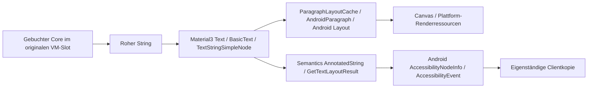

# §90a – Consumer-Ende am konkreten Compact-Textpfad

Basis `20fd926dd454153fcc742bbb2d89e156a3d6108f`, #37, ergänzend #33/#34.
**NO-GO:** Für `CompactActiveContent → Text(person.pseudonym/task.title)` ist kein
eingesetzter API-Vertrag nachgewiesen, der sämtliche alten Text-/Layout-/Semantics-/
Renderkopien beendet oder deren gemeinsame maximale Restbelegung vorab begrenzt.
Das Stopgate von §89a B ist damit nicht bestanden. Kein vertikaler Umsetzungsschritt,
keine neue Owner-/Cachearchitektur und kein weiteres Retirementsignal.

## Tatsächlich eingesetzter Pfad und Quellen

[Offline aufgelöste P77-Runtime-Abhängigkeiten](dependencies.log): Material3 **1.4.0**,
Foundation/UI/UI-Text/Runtime **1.12.1**, nicht aus einem beliebigen Cachefund oder
einem aktuellen Upstream-HEAD angenommen. [Artefaktkoordinaten und SHA-256](artifacts.json),
[zwölf konkrete Sourceeinträge mit Zeilenmarkern/Hashes](source-index.json),
[passende AAR-Klassenfelder](compose-binary-contract.txt).
[inspect-sources.py](inspect-sources.py) prüft Sourcejar-/AAR-Hashes derselben
aufgelösten Koordinate; die Binärsignaturen bestätigen die relevanten Felder.
Kein vollständiger Source/Binary-Rebuild oder fremder Produktcode übernommen.
App: minSdk 30, compile/target 37; frühere Gerätebelege (§88a) betreffen API 33.
Hier kein neuer Geräte- oder OEM-Native-Binärcode-Nachweis.

| Station im einen Produktpfad | Konkreter Befund / Vertragsgrenze |
|---|---|
| `ProductViewModel.activeCore`, `ActiveWorkspace.kt:100–108,160–199` | Der ursprüngliche Core wird nach Autoritätsprüfung als roher Wert weitergegeben; beide Schleifen rufen `Text(String)` auf. `key(activeArea)` ersetzt den Teilbaum. Die Text-API bekommt weder Load-/Budgetidentität noch einen verfolgbaren Consumer-Lease. |
| Material3 `Text.kt:102–147` → Foundation `BasicText.kt:92–166` | Die String-Überladung reicht an BasicText durch. Mit den hier verwendeten Defaults, ohne SelectionContainer/onTextLayout/autoSize, entsteht `TextStringSimpleElement/Node`. Im Produkt wird kein SelectionRegistrar oder Background-Messexecutor bereitgestellt; dessen Android-Default ist null. Kein fiktiver zusätzlicher Prefetchworker als Befund. |
| `TextStringSimpleNode.kt:74–112,326–374,450ff`; `ParagraphLayoutCache.kt:49ff,367ff` | Node und Layoutcache halten den String, Paragraph und Intrinsics. Semantics erhält `AnnotatedString(text)`; GetTextLayoutResult kann zusätzlich ein Layoutresultat mit TextLayoutInput und MultiParagraph erzeugen. Es gibt keinen per-Core-Schlussvertrag für alle herausgegebenen Resultate. |
| UI-Text `ParagraphIntrinsics.android.kt:57ff,167ff`; `AndroidParagraph.android.kt`; `TextLayout.android.kt:123ff,388ff,817ff` | CharSequence/ggf. Spannable, Paint/Font-/Layoutzustand; Android BoringLayout oder StaticLayout, anschließend `layout.draw(canvas)`. Das sind zusätzliche Ressourcen und mögliche Repräsentationen, keine belegten Nullkosten und keine mitgelieferte Gesamtbytegrenze. |
| `AndroidComposeViewAccessibilityDelegateCompat.android.kt:398ff,1201ff,1313ff,2630ff` | Vorherige Semantics werden zum Diff lokal kopiert/ersetzt. Text wird in Accessibility-Spannables/NodeInfo sowie gegebenenfalls Eventtext überführt und an den Parent/Frameworkcaller übergeben. Lokales Map-Clear ist kein Rückruf ausgelieferter Werte. |

## Geprüfte konkrete API-Kandidaten

| Mechanismus / technische Quelle | Reicht nicht für den verlangten Vertrag, weil … |
|---|---|
| `DisposableEffect`, Node-Detach, Composition-/Activity-Dispose | Beenden bekannte UI-Lifecycles. String-/Layout-/Accessibilitywerte, die ein anderer Consumer bereits hält, sind davon nicht erfasst. Der Node besitzt keinen allgemeinen Close-Ack für sie. [§86a](../p11-p86a/assessment.md) belegt den bereits entnommenen Wert trotz Clear/Dispose. |
| [ViewTreeObserver.registerFrameCommitCallback](https://developer.android.com/reference/android/view/ViewTreeObserver#registerFrameCommitCallback(java.lang.Runnable)) | Bezieht sich auf einen gerenderten und zur Swapchain übergebenen Frame, nicht auf das Ende aller vorherigen Frames oder sämtlicher Java-/Semanticskopien. Kein Last-Consumer-Ack und keine Byteobergrenze. |
| [RenderNode.discardDisplayList / computeApproximateMemoryUsage](https://developer.android.com/reference/android/graphics/RenderNode#computeApproximateMemoryUsage()) | Ein Displaylistreset betrifft den jeweiligen RenderNode. Die Speicherangabe ist ausdrücklich approximativ und schließt unter anderem Kind-RenderNodes/Bitmaps aus. Kein vorab garantierter Gesamtbound. Compose `RenderNodeLayer.destroy()` verwirft seine Liste und recycelt den Layer; ein Text besitzt dabei nicht zwingend einen eigenen solchen Layer. |
| [AccessibilityService.onAccessibilityEvent](https://developer.android.com/reference/android/accessibilityservice/AccessibilityService#onAccessibilityEvent(android.view.accessibility.AccessibilityEvent)) | Der öffentliche Vertrag erlaubt Services ausdrücklich, für weitere Verwendung eine eigene Eventkopie anzulegen. Der Callbackrücklauf beendet deshalb nicht diese Kopie. Es gibt hier keine maximale Aufbewahrungsdauer/-anzahl oder einen Rückruf dieser Clienttexte zum ursprünglichen Coreowner. |
| [AccessibilityNodeInfo.setText/recycle](https://developer.android.com/reference/android/view/accessibility/AccessibilityNodeInfo#setText(java.lang.CharSequence)), [AccessibilityEvent.recycle](https://developer.android.com/reference/android/view/accessibility/AccessibilityEvent#recycle()) | Nodeinfos werden vor Auslieferung an den Service unveränderlich; der Appowner kann ausgelieferte Clienttexte damit nicht löschen. recycle ist ab API 33 wirkungslos, auch früher kein Ack aller unabhängigen Kopien. |

**Entscheidender Gegenfall, kein hypothetischer Vendorfehler:** Ein zugelassener
Accessibility-Client kopiert den bereits ausgegebenen synthetischen Pseudonym-/
Tasktext und behält ihn nach dem Callback. Das ist durch die API vorgesehen.
Navigation, Lock oder Recreate des Appviews kann diese unabhängige Kopie nicht
zurückholen. Keine Behauptung, dass TalkBack stets alle Texte unbegrenzt speichert:
Es fehlt der Vertrag, der Aufbewahrung für alle zulässigen Consumer begrenzen würde.

Auch unter enger Betrachtung **nur des Appprozesses** ergeben die lokalen Caches
und RenderNode-Messwerte keinen gemeinsamen konservativen Bound für alte/neue
Layouts, temporäre/native Repräsentationen und bereits exponierte Strings. Eine
begrenzte aktuelle Karten-/Stringzahl begrenzt nicht automatisch Anzahl und Bytes
aller alten Consumerrepräsentationen. Externe Servicekopien sind ein zusätzlicher,
separater Umfangspunkt; ihre Nichtzählung löst den internen Native-Bound nicht.
Auch der tatsächlich vorhandene `ParcelSafeTextLength=100000` begrenzt nur einen
Accessibilitytext für die Übergabe, nicht Zahl/Lebensdauer seiner Kopien oder die
gesamte Layout-/Renderbelegung. Lokale Cache-/Textlimits sind kein Gesamt-Restbound.

## Lock, Navigation und Recreate

Der originale Revoke sperrt weitere autorisierte Corezugriffe; das bleibt wirksam.
`key(activeArea)`/Dispose entfernen UI-Zugehörigkeit, ohne alte Stringwerte zu
mutieren. `MainActivity.onDestroy` schließt Runtime; Recreate erzeugt die neue
Activity/Composition. Kein dieser Schritte quittiert bereits ausgegebene
Layout-/Semantics-/Clientkopien. Neue Session/VM ist daher kein physischer Endbeweis
und keine Grundlage, alte Buchung automatisch zurückzusetzen. GC, WeakReference,
leerer Slot oder ein opaque Handle ändern diese Feststellung nicht. Die in §88a
belegten SQLCursor-/Window-Enden betreffen diesen Textconsumerpfad nicht.

## Jetzt erforderliche ausdrückliche Produktentscheidung

Nicht garantierbar ist **eine feste maximale Restbelegung bzw. ein bestätigtes
Ende aller vom dargestellten Core abgeleiteten Kopien pro Generation**, das erneute
Materialisierung unter dem unveränderten umfassenden 8+8-MiB-Vertrag legitimiert.

Für Fortsetzung muss ausdrücklich entschieden werden, ob **8+8 MiB künftig nur
das vollständig kontrollierte App-Daten-/Staginginventar begrenzen soll**, während
Framework-/Native-/bereits ausgelieferte Accessibilitykopien als benannter, nicht
hart begrenzter Restumfang separat behandelt werden. Das wäre eine Änderung von
Budgetumfang und Nachweisanspruch, keine nachträgliche Kalibrierung; diese Kosten
werden dadurch nicht null. Die Autoritätsgarantie bliebe „kein neuer unautorisierter
Zugriff“, nicht „alle bereits dargestellten Strings sind zurückgerufen/gelöscht“.

Bleibt die umfassende Kopien-/Native-Budgetgarantie unverändert, kann dieser normale
Compose-Text-/Semantics-Ausgabepfad die Voraussetzung nicht erfüllen. Dann müsste
der geschützte Darstellungspfad bzw. dessen Produkt-/Accessibilityanforderung
ausdrücklich neu entschieden werden; hier ist kein nachgewiesener Ersatz vorhanden.
Allein Accessibility abzuschalten würde den internen Render-/Layout-Bound nicht
herstellen. **Keine dieser Änderungen wird hier beschlossen oder implementiert.**

## Begrenzung und Abschluss

Nur dieser Produktpfad untersucht; keine erneute Variantenstudie. Vorhandene
§§83/86a/88a-Belege wiederverwendet, Dependencyauflösung offline und Source-/AAR-
Hashes geprüft. Kein zusätzlicher P77-Gegentest: Die dokumentierte zulässige
Clientkopie und der vorhandene Consumer-Escape-Gegentest reichen zur Falsifikation
eines globalen End-Acks; ein weiterer endlicher Heap-/onDraw-Lauf bewiese keine
Restobergrenze. Keine Kompilierung, Testsuite oder neue Performancewerte behauptet.
Produktquellen und Gates bleiben unverändert. #37/#44 aktualisieren, WIP pushen,
**STOPP zum unabhängigen Review und zur bewussten Produktentscheidung. Kein
eigenständiger §91 mit derselben Analyse, kein Merge/Release.**
