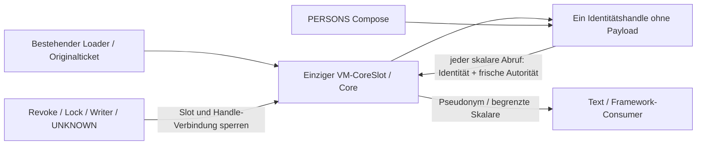

# §92a – Kontrollierte Datenübergabe: kompakte Personenansicht

Basis `0211b5fa75a18cc57f5ff187608c74fb6f29fe93`, #37 (ergänzend #33/#34).
Ausschließlich `ProductViewModel → CompactActiveContent → PERSONS → Text(pseudonym)`.
WIP, keine schnelle Navigation, kein Reuse oder Full-Workspace-Fallback.

## Konkrete Übergabe

Die PERSONS-Verzweigung liest `activeCore` nicht mehr und übergibt keinem ihrer
Composables einen `ActiveCorePayload`, eine Seite, Karte oder Liste.
Der neue Overload von `CompactActiveContent` erhält genau ein
`CompactPersonsPresentation` pro originalem CoreSlot. Zwei Instanzfelder:
Slot-Identität und eine widerrufbare Verbindung zum bestehenden ViewModel.
Keine Payload-Registry, kein Cache, keine Session-/Schlüsselautorität.

Das Objekt liefert ausschließlich autorisierte skalare Werte: Seitengröße (0..32),
Gesamtzahl, weitere Einträge, einzelne Statuscounts und ein Pseudonym per Index.
Es hält keine aufgelösten Werte. Ungültige Indizes werden ohne Ownerzugriff abgelehnt.
Jeder echte Abruf prüft Ownerthread, ursprüngliche Slot-Identität, PERSONS-Route,
aktuellen ACTIVE-Actionbezug, lokale **und frische** READY-Generation und die
Original-Lifetime. `authorizeHit()` prüft den bestehenden zentralen READY-Zugang
und Writer-/Mutationsepochen-Ticket erneut; `publish()` und abschließende Prüfungen
sichern die kurze Rückgabe ab. Kein SQL-Read, kein neuer Ticket und keine Idle-Erneuerung.
Die Benennung `authorizeHit()` aktiviert keinen Navigations-Reuse-Schalter.

Bei Invalidation oder terminaler Abrufverweigerung wird die Owner-Verbindung des
Handles gelöscht. Ein altes Handle kann nicht einer späteren Slot-Identität folgen.
Bereits weitergereichte Strings lassen sich dadurch nicht zurückrufen.
`compositionObserved/Disposed` liefern nur Metadatensignale; sie geben keinerlei
Core-Admission oder Speicher wieder frei. `OutstandingCoreRead` bleibt unverändert.

Andere ACTIVE-Ansichten erhalten weiterhin ihren bisherigen Core. Ihr Inhalt und
Editor-/Full-Workspace-Pfade bleiben gleich. Nur der vorhandene Frame-Observer-
Modifier wurde ohne Vertragsänderung für beide Overloads extrahiert.

## Vorab gebuchte app-kontrollierte Daten

`CompactPersonsPresentationBudget.reservation` wird als disjunkter Zusatz zum
bestehenden `ActiveCoreStore.envelope` in **derselben** `CoreReadAdmission` vor
Materialisierung gebucht. Kein zweites Ledger und keine nachträgliche Gratiszulassung.

| Zusatz | Engineering-Units / Bytes |
| --- | --- |
| Retained | 1 Handleobjekt + 3 Referenzen = **152 B** |
| Transition | 32 Scratch-/Builder-/Closure-/Box-Objekte, 128 Referenzen, 32 Strings mit je höchstens 128 UTF16-Einheiten, 64 Arrays mit zusammen 32.768 Payloadbytes = **61.088 B** |

Die neun begrenzten formatierten Zeilen sind Seitenlabel plus acht Statuszeilen;
Long-/Int-Werte sind längenbegrenzt. Die Reserve zählt ausdrücklich auch
Konkatenations-/Zahlzwischenwerte und Builder-Wachstum (bis 256 UTF16-Einheiten
pro Buffer), nicht nur die neun fertigen Texte. Resolver laufen seriell auf dem Ownerthread,
verwenden keine Seitenkopie und keinen Listenbuilder. Pseudonyme aliasieren die
bereits im Core gebuchten Strings. Die ViewModel-Instanz wird nicht dupliziert;
die zusätzliche Verbindung ist oben gebucht und explizit widerrufbar.

Aufgelöste Texte gehen direkt an `Text`, ohne Remember-/State-/Form-/Listencache
in der App. Von Compose/Android gehaltene Texte, Layout-/Semantics-/Renderkopien
gehören gemäß Option 2 zur **separat zu bewertenden Frameworkseite**. Sie sind
weder kostenlos noch als vollständig freigegeben bewiesen. Die oben genannten
Engineering-Charges sind keine ART-/Native-/PSS-Obergrenze und keine physische
Wipegarantie. Auch gelöschte Slot-/Handle-Verbindungen sind kein Endnachweis für
noch exponierte Ressourcen. R8/T16 sowie alle bisherigen Sperren bleiben bestehen.

## Gezielte Belege

**60 unterschiedliche Host-Testfälle PASS, 0 FAIL** nach gezielten Nachläufen:
23 `ActiveCoreOwnerTest`, 12 `ProductActiveCoreLifetimeTest`,
16 `OutstandingCoreReadTest`, 5 `CoreReadAdmissionBudgetTest`, 4 `P83OverlapBudgetTest`.
[Bilanz](test-summary.json), [erste Daten-XML](host-xml/),
[abschließende/ergänzende XML](host-rerun-xml/), [abschließender Build-/Testlauf](verification.log).

Neue Hostfälle: dieselbe Handleidentität, genau zwei Instanzfelder (Compose erzeugt
zusätzlich eine statische Konstante), 32 exakte Unicode-Pseudonyme, ungültige
Indizes und 33er-Candidate verweigert; alte Zugriffe nach Lock, Revoke,
Generation-/Action-/Statuswechsel und frischem Session-Denial ohne Observerupdate;
keine Wiederbelebung nach später wieder gültigen Bedingungen; Foreignthread,
Revoke während Publication, neues Slotziel und verspätete alte Lieferung.
Keine zusätzlichen Port-Reads oder Idle-Erneuerung durch Abrufe. Die bisherigen
realen Ticket-/Writer-/UNKNOWN-/Main-/Cleanup-Fälle bleiben bestanden.

Der neue Budgetfall fügt die Presentation-Reserve **vor** Materialisierung in
die gemeinsame Admission ein: R8/T16 exakt PASS, ein zusätzliches Retained-Byte
REFUSED ohne Materialisierung. Die übrigen exakten Grenz-/Overflowfälle bleiben
bestehen. Große echte Host-SQLite-Fixture mit 200/1.000/5.000 und Unicode:

| Rollen | R-Receipt (Bytes) | T-Receipt (Bytes) |
| --- | ---: | ---: |
| 6 | 1.605.364 | 6.458.128 |
| 32 | 1.819.508 | 7.314.704 |
| 100 | 2.376.120 | 9.541.152 |

Alle numerisch ADMITTED; **keine neue 100-Rollen-Produktfreigabe**. Die neue
Presentation bucht +152 R / +61.088 T gegenüber §91a. Bei gleichzeitig stark
referenzierten alten/neuen Werten bleibt die Überlappungsfixture über T16;
der Loader lehnt den zweiten Read vor SQL weiterhin ab, auch nach Dispose.

P77-App, P77-Android-Test-APK und Release-Build einschließlich Lint-Vital **PASS**.
Die abschließende reine Probeänderung wurde separat gebaut
([Log](android-probe-build-final.log)). [APK-Hashes](apk-sha256.txt),
[Reproduktionsbefehle](commands.sh). Vorläufige Logs bleiben erhalten:
[erster Hostlauf](host-tests-initial.log) hatte nur den zu strengen Feldtest
wegen der statischen Compose-Konstante; die Instanzfelder werden jetzt separat
geprüft. Die spätere Reserve-Erweiterung für Konkatenation/Builder wurde erneut
mit betroffenen Tests und allen Builds geprüft. [Bytecode des Seitenlabels](page-label-bytecode.txt)
zeigt `invokedynamic`-Konkatenation; daraus wird keine konkrete D8-/ART-/Native-
Allokationsgarantie abgeleitet. Der reservierte Engineering-Spielraum zählt
Zwischenwerte ausdrücklich mit; physische Kalibrierung bleibt separat.

### Ein isolierter P77-Gerätefall

Samsung SM-M526BR, Android API 33, echter `ProductRuntime`, SessionCoordinator,
Repositories, SQLCipher und Compose; normale `stress`-Fixture mit
200 Personen / 1.000 Tasks / 5.000 gespeicherten Events, langen Unicode-Pseudonymen.
Kein zusätzlicher Schlüssel-/Sessionowner. P86-Testactivity erhält den vorhandenen
optionalen Compact-Port ausschließlich im Instrumentation-Setup; ihre bisherigen
Produkt-/Full-Workspace-Pfade werden nicht umgebaut. Beide Reuse-Schalter bleiben aus.

[Test-Rohbeleg](android-probe.log): 32 exakte Pseudonyme über das Handle,
32-von-200-Label und erste Pseudonymzeile über **sichtbare tatsächliche Text-Nodes**
bestätigt. Der Einstieg verwirft einen noch unveröffentlichten Hub-Worker und wartet
auf dessen echte Shell-Quittierung, bevor PERSONS erstmals lädt. Er umgeht keine
Expositionssperre und aktiviert keine neue Navigation. Exakt ein materieller
Core-Read für PERSONS; kein vollständiger Workspace im ViewModel.

Danach: Writer-Pending und kontrolliert injizierte **Protokoll-Metadaten-UNKNOWN**
sperren das alte Handle; keine Behauptung eines echten SQLCipher-/Vendorfehlers.
Doppelte späte Main-Shells, Lock und Dispose liefern keine weiteren Werte und
keine Wiederzulassung. Ein zweiter Core-Load wird abgelehnt, Readcount unverändert,
Retirement bleibt UNCONFIRMED. Fixture-Cleanup bestätigt.

Die Vorläufe desselben Gerätefalls scheiterten am Sichtbarkeitsoracle:
[erster Lauf](android-probe-initial.log), [Scroll-Vorlauf](android-probe-scroll-initial.log),
[Accessibility-Vorlauf](android-probe-accessibility-initial.log),
[Textsuche-Vorlauf mit bereits sichtbaren Pseudonym-Nodes](android-probe-text-search-initial.log).
UiAutomation wird jetzt vor dem Activitystart initialisiert; der Test wartet auf
Composition-Commit und nutzt wie die vorhandenen Probes exakte Node-Traversierung
statt `findAccessibilityNodeInfosByText`. Das Label und die Pseudonyme werden nicht
wegen eines Owner-only-Checks als sichtbar behauptet. Keine Produktionsänderung
zur Umgehung dieser Testprobleme.

Keine Gesamtsuite, kein 129k-Lauf, keine neue Latenz-, ART-/Native-/PSS- oder
Renderrestgrenzenmessung. Sichtbare Nodes/Composition-Commit sind ausschließlich
UI-Testbelege, niemals Endnachweis oder physische Freigabe.

## Ergebnis / verbleibende Grenzen

Dieser einzelne Personenpfad ist konkret verbunden, ohne neue app-eigene
Payloadkopie oder unabhängige Datenwurzel. Die Verbindung zum einzigen Owner ist
identitätsgebunden, widerrufbar und gebucht. Die allgemeine Owner-/Form-/Task-/
Presentation-Integration sowie Framework-/Native-Ressourcenbewertung aus #33/#34/#37
sind damit nicht abgeschlossen. Keine rückwirkende Textlöschung oder Wipegarantie.

WIP pushen, **STOPP zum unabhängigen Review**. Kein Merge/Release.
