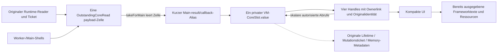

# §96a – direkte Core-Borrow-Oberfläche schließen

Basis `40014aae1ececac97ec6256351883be60eb41384`, #37 (ergänzend #34).
WIP zur unabhängigen Prüfung; kein Merge/Release.

## Inventar und Entscheidung

[Vollständiges Zeileninventar vorher](call-sites-before.txt),
[gruppiert mit Pfad/Zeile](inventory.json), [Suche nachher](call-sites-after.txt).
Die Suche enthält auch `runtime.activeCore`: Das ist der bestehende Loaderport,
**nicht** der entfernte ViewModel-Getter. Anzahl im JSON bezeichnet Quellzeilen,
nicht logische Aufrufe (mehrere Aufrufe können in derselben Zeile stehen).

| Bereich | Befund / Behandlung |
| --- | --- |
| Produkt-UI/Composables/Callbacks außerhalb des VM | Keine verbleibende Nutzung der beiden VM-Borrow-APIs. Alle vier kompakten Renderer verwenden bereits Handles. |
| `ProductViewModel` | Zwei öffentliche Deklarationen und drei interne Navigationsprüfungen. Getter und `observeActiveCoreComposition(core)` entfernt. Interne Prüfungen verwenden nur noch das private boolesche `currentCoreSlot(slot)`. |
| `MainActivity` | Bindet `runtime.activeCore` als ursprünglichen Producerport ans VM. Unverändert, kein VM-Borrow. |
| Notwendige interne Haltung | Privates `CoreSlot.value: ActiveCoreResult.Value`, ursprüngliche Loader-Zelle, kurze Worker-/Main-Lokale und autorisierte private Scalar-Resolver bleiben erhalten. Der Owner muss seine Daten weiterhin selbst besitzen/prüfen. |
| Host `ActiveCoreOwnerTest` | Bisherige Getter-/Observer-Nutzung vollständig auf Handlewerte, opaque Originalidentitäten, Port-/Producer-Metadaten, Publication-/Refusal-/Revoke-/Readcount-Verträge umgestellt. |
| Android P73/P74/P81/P82/P85/P85b/P86/P92–P95 | Präsenz-/Identitätsprüfungen über testseitige Handleidentität; P81/P82 fachliche Counts/Seitengrenzen über vorhandene Handles. Keine produktive Hilfsschnittstelle. P88 nutzt nur den Runtime-Loader und brauchte keine Umstellung. |
| Historische Android P77/P83/P84 | Reine Objekt-ID-Korrelation liefert nur einen skalaren Hash über androidTest-Hilfe. P77 hält für seinen alten escaped-root-/Heap-Oracle ausdrücklich lokal einen reflektierten Alias; P83 inspiziert lokal den ursprünglichen Core für den vorhandenen Zensus. P84-Counts verwenden Handles. **Keine** gemeinsame Hilfsfunktion liefert einen Core/Slot/eine DTO-Liste zurück. |

Es gibt keinen produktiven Aufrufer, der eine vollständige Core-Ausgabe außerhalb
des Owners benötigt. Die Stopbedingung ist deshalb nicht eingetreten.
Die boolesche Navigation prüft weiterhin den ursprünglichen Slot, Session/
Generation/Action und Lifetime um die unveränderte zentrale Hit-Publication herum.
Sie aktiviert keinen Reuse-Schalter und gibt keine Payload oder Lifetime heraus.

## Keine Ersatz-Borrow-API

Es wurde **kein neuer produktiver Getter**, auch kein Testgetter, eingeführt.
`CoreOwnerIdentityTestSupport.kt` existiert ausschließlich in `androidTest`:
aktuelles Handle → dessen opaker `Any()`-Identitätstoken, ohne Rückverweis zum Core;
der getrennte historische Zensushelfer liefert nur eine numerische Objekt-ID.
Hosttests lesen ebenfalls nur das private Identitätsfeld eines bereits verfügbaren
Handles, nie `CoreSlot.value` aus dem VM.

Die beiden ausdrücklich lokalen privaten Zensusinspektionen sind privilegierte
**historische Testdiagnostik**, keine Ersatzschnittstelle oder neue Produktwurzel.
Sie werden nicht als aktuelle Produkt-UI-/Speicherabnahme ausgegeben. Insbesondere
sind alte direkte Compose-Core-Root- und feste Hitcount-Annahmen aus P77/P81/P82/
P83/P84 nach §§92–95 nicht pauschal neu bestätigt. Hier wird ihre Kompilierbarkeit
migriert; keine historische Gerätesuite neu ausgeführt und keine Rohbelege umgedeutet.
Eine Getterentfernung schützt nicht vor beliebiger privater In-Prozess-Reflection.

[Öffentliche kompilierte VM-Signaturen](viewmodel-jvm-surface.txt) und Hosttest:
`getActiveCore`/`observeActiveCoreComposition` fehlen; normale öffentliche Methoden/
Felder geben weder Core, vollständige Coreseiten noch `CompactFunctions` zurück
oder nehmen diese als Beobachtungsargument an. Compilerbrücken sind keine neue
produktive Borrow-Oberfläche. Die vier `CompactActiveContent`-Signaturen bleiben
auf genau die vier vorhandenen Handletypen beschränkt.

## Tatsächlicher app-kontrollierter Referenzgraph

Die Lokalen/Handoff-Zelle können denselben Graphen während der Übergabe referenzieren;
das sind keine zweiten unabhängigen Payloadregistries. Nach der Main-Übernahme
enthält die Loader-Zelle keine weitere Payload. Lifetime-/Memory-Metadaten bleiben
für Autorität, späte Shells und die Expositionssperre bestehen. Handles speichern
keinen Core/keine Seitenkopie; HUB hält nur seine gebuchten Metadatenhüllen und
Callbacks, FUNCTIONS zusätzlich nur den skalaren Indexbound.

**Noch nicht vollständig integriert:** bestehende Fullview-/`WorkspaceSnapshot`-
Pfade und deren öffentliche Darstellung, Form-/Editorzustände (`TaskModel`,
`OperationsModel` usw.), Request-/Callback-Lokale sowie alte/neue Snapshot- und
Consumerreferenzen. Ihre gemeinsame Owner-/Budget-/Lebensdauerintegration ist
mit dieser Änderung nicht gelöst. Keine neue Cache-/Fullview-Architektur und kein
neuer Fallback. Bereits ausgegebene Frameworktexte/Layouts/Semantics/Renderressourcen
können weiter existieren; Option 2 behandelt sie separat, nicht als kostenlos.

Das Löschen eines Getters oder VM-Slots ist **kein physischer End-/Wipebeweis**.
Ein Hostgegenbeispiel hält denselben ursprünglichen Producer-Testinput und einen
rechtmäßig ausgegebenen Summarytext nach Clearing/mehrfachem Dispose weiter fest.
Es muss dafür keine neue Payload aus dem VM ausgeliehen werden.
`OutstandingCoreRead` bleibt nach unbestätigter Exposition reserviert. Kein Dispose,
Frame-Commit oder GC erzeugt Retirement, Reset oder Readmission.

## Erhaltene Gegenprüfungen und Rohbelege

**78 unterschiedliche Hostfälle PASS**, 0 FAIL: 39 `ActiveCoreOwnerTest`,
6 `CoreReadAdmissionBudgetTest`, 12 `ProductActiveCoreLifetimeTest`,
16 `OutstandingCoreReadTest`, 5 `P83OverlapBudgetTest`.
[Verifikation](verification.log), [Binding-Oracle-Nachlauf](host-binding-followup.log),
[XML](host-xml/), [Bilanz](test-summary.json).

Umstellung ohne Entfall der fachlichen Aussagen:

| Bisherige Aussage | Neuer Oracle |
| --- | --- |
| Derselbe Core bei isoliertem Testport-Navigationshit / keine Doppelinstallation | Derselbe Originaltoken über die unterschiedlichen vorhandenen Handletypen, originale Lifetime, einmaliger Portread, unveränderte Publications/Hitcounts. |
| Personen total/hasMore; Aufgaben open/hasMore | Tatsächliche PERSONS-/TASKS-Handlewerte; der vorhandene isolierte Fakeport ermöglicht nur im Hosttest deren Navigation. Die übrigen vollständigen Titel-/Pseudonym-/Funktions-/Hub-Gegenprüfungen bleiben bestehen. |
| Action-ID b nach Wechsel; Generation-/Foreign-Candidate-Rejection | Aus dem tatsächlichen Producerresult abgeleitete skalare Port-ID b, Auswahl b und installierter Originaltoken; unveränderte falsche Action-/Generation-/Status-/Budget-Candidates werden weiterhin abgelehnt. |
| Lock/Worker-Revoke vor Compose-Dispatch; Clearing/late/duplicate Main | Handleidentität/Original-Lifetime vor und nach Dispatch, kein Wiederaufleben und kein neuer Read. |
| Exponierter Altbestand nicht durch Slotclear/Dispose physisch verschwunden | Weiter gehaltener ursprünglicher Producer-Testinput plus bereits ausgegebener Summarytext, widerrufenes Handle, unveränderte Disposal-Metadaten. |

R8/T16, alle vier Handle-/Formatierungsbuchungen und gemeinsame Admission sind
unverändert. [Git-Blobvergleich](unchanged-boundaries.json) bestätigt dies für
Budgetdefinitionen, CoreReadAdmission, OutstandingCoreRead, Loader und Lifetime.
[Produktive Änderungsdateien](production-files-changed.txt): ausschließlich
`ProductViewModel.kt`. Keine Session-/Writer-/UNKNOWN-/Revoke-/Crypto-/Storage-
oder Berechtigungsänderung, keine zusätzliche app-kontrollierte Payloadkopie.

P77-App, P77-Test-APK und Release einschließlich Lint-Vital PASS. Der erste
Compileversuch der historischen P77-Testinspektion traf auf einen nur für
MainActivity typisierten Reflection-Helfer; lokale explizite Feldinspektion
korrigiert ([ursprünglicher Compilebefund](initial-verification.log)).
Danach alle angepassten Androidprobes kompiliert; reine historische ID-Korrelation
anschließend auf skalaren Helfer reduziert und erneut gebaut
([abschließender Test-APK-Build](final-test-apk-build.log)). Keine Produktionslücke
oder Vendor-Cleanupstörung daraus abgeleitet.

### Ein isolierter P77-Gegentest mit vier frischen Routenscopes

Samsung SM-M526BR/API 33, [Rohlog](android-probe.log), [APK-Hashes](apk-sha256.txt).
Je Route neuer expliziter P77-Runtime-/Fixture-Scope (`p86-small`: 20 Personen,
40 Tasks, 6 Rollen). HUB/PERSONS/TASKS/FUNCTIONS: API reflektiv absent, Handlewerte
und repräsentative tatsächliche Texte sichtbar, exakt ein materieller Core-Read,
kein Fullworkspace im VM. Für Nicht-HUB wird ein **unveröffentlichter** Worker
verworfen und seine wirkliche Quittierung abgewartet, bevor die erste Route lädt.
Kein Wechsel auf einen neuen Core nach Exposition und kein aktivierter RAM-Hit.

In jedem Scope Writer-Pending/Protokoll-Metadaten-UNKNOWN, alte Handles und doppelte
Main-Shells geprüft: kein Wert/kein neuer Read; zweite Admission DENIED,
Retirement UNCONFIRMED; Lock und Fixture-Cleanup bestätigt. Beide Reuse-Schalter
false. Der frühere erfolgreiche Lauf vor der rein testseitigen historischen
Metadatenverfeinerung ist getrennt erhalten, der finale Lauf verwendet das finale
Test-APK. Keine neue Geräte-Gesamtsuite, keine 129k-Serie, keine neue Performance-
oder physische Speicherfreigabebehauptung.

## Ergebnis / Reviewgrenze

Gewöhnliche produktive UI-/Callback-Consumer können keinen vollständigen Core
mehr über diese beiden VM-APIs ausleihen. Interner Originalowner und alle bisherigen
Admission-/Cleanup-Sperren bleiben erhalten. Fullview/Form/Editor/Alt-/Neu-Integration
weiter offen, kein globaler Ressourcen-Endnachweis.
`reuseEnabled=false`, `ramReuseEnabled=false`, keine automatische Readmission.
WIP pushen und **STOPP zum unabhängigen Review**; kein Merge/Release.
