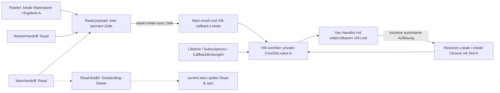

# §97a – Original-Core-Referenzkette und Beendigungsbedingungen

Basis `98554d300df608837940e17b1403e3a05a666fbd`, #37 (ergänzend #34).
**Ergebnis: Teilketten CONFIRMED, globale Beendigung nach Exposition BLOCKED.**
Nur Tests/Dokumentation geändert. Keine neue Freigabe, Architektur oder Produktimplementierung.

## Bedeutung der Einstufung

- **CONFIRMED:** Die benannten Referenzstellen für genau die ursprüngliche Identität
  sind im untersuchten Ablauf beendet und ihre erforderlichen Aufruf-/Handoff-
  Quittierungen belegt. Keine Aussage über physisch zurückgewonnene Heapbytes.
- **BLOCKED:** Eine konkret benannte app-eigene Referenz oder erforderliche
  Endquittierung besteht noch beziehungsweise ist nicht als beendet nachgewiesen.
- **OUT OF SCOPE:** Framework-/Native-/Accessibilityressourcen oder nicht integrierte
  Fullview-/Formular-/Editorzustände. Weder kostenlos noch freigegeben angenommen.

Die Referenzprüfung betrifft einen Original-Core A. Ein leerer Original-Slot ist
nicht mit einem vollständig beendeten app-kontrollierten Referenzgraphen identisch.
Die positive Aussage für A erlaubt auch keine pauschale Aussage über neue Identität B.

## Tatsächlicher produktiver Pfad

Primärquellen sind die **unveränderten** Dateien
[Loader](../../data/src/main/kotlin/org/pag/data/product/ProductActiveCoreLoader.kt),
[Outstanding-Record](../../data/src/main/kotlin/org/pag/data/product/OutstandingCoreRead.kt),
[Lifetime](../../data/src/main/kotlin/org/pag/data/product/ProductActiveCoreLifetime.kt),
[Reader](../../data/src/main/kotlin/org/pag/data/product/ProductActiveCoreReader.kt),
[ViewModel](../../app/src/main/kotlin/org/pag/prototype/product/ProductViewModel.kt)
und die vier Präsentationshandles. [Blobnachweis](unchanged-production.json).
Die Pfeile bezeichnen Referenzen/Erreichbarkeit, nicht zusätzliche Eigentümer oder Kopien.

## Referenzstellen: erster Besitz, tatsächliches Ende, offene Bedingung

| Stelle | Ab wann A erreichbar sein kann | Nachweisliches Ende der untersuchten Kante / Quittierung | Einstufung und verbleibende Bedingung |
| --- | --- | --- | --- |
| Reader-/Materializerlokale | Während `ActiveCoreStore.read`, später kompletter `ActiveCoreResult.Value` in `readForTicket`/Workeraufruf | Der synchrone `readCandidate`-Aufruf muss wirklich zurückgekehrt sein; danach `dispatchWorker`-Finally/`workerEnded` | **BLOCKED während des Aufrufs**. Im kontrollierten Producer **CONFIRMED** nach Rückkehr/Worker-ACK ohne externe Retention. Keine neue globale Abnahme aller Room-/Coroutine-/Storage-internen Halter. |
| `Read.payload` | `candidate(result)` nach gemeinsamer Admission und Scope-Endmarkern | `takeForMain().getAndSet(null)` oder `revoke/noWorker` leert genau diese Originalzelle | **CONFIRMED Zellenkante** nach Leerung. Main-Ergebnislokale/VM-Slot können A weiterhin halten. |
| `workerWork` / ausführender Worker | Nach `queueWorker`; die Closure hält Callback/VM/Lifetime, Ergebnis später lokal oder transitiv über die Zelle/VM | Zelle wird vor `run()` geleert; **Aufrufende** erst bei `workerFinished` im äußeren Finally | Feld leer allein **BLOCKED**. Cancel vor Materialisierung + tatsächlicher Shell-ACK: **CONFIRMED benannte Originalkette**, kein Core erzeugt. |
| Worker-/Main-Shellobjekte | `WorkerHandoff(read)`/`MainHandoff(read)`, zunächst nur Routing; später transitiv zum Core | Dispatch-CAS verhindert doppelte Ausführung; ihre `read`-Referenz selbst wird nicht gelöscht | Für Original-A-Zellen nach ungepublizierter Verwerfung/ACK **CONFIRMED**. Allgemeine Bindungs-/Zukunftsisolierung **BLOCKED**: `Read` ist `inner` und hält den Owner, dessen `current` später B sein kann. |
| `mainWork` | `queueMain` nach Materialisierung; Closure hält u.a. ursprünglichen Callback und Lifetime | Zelle vor Dispatch geleert oder bei Revoke gelöscht | **CONFIRMED Zellenkante**, aber aktive Runnable-/Callbacklokale noch **BLOCKED**. |
| Main-`result`, VM-Callbackparameter `result/core/slot` | `takeForMain` bzw. Aufruf des ursprünglichen VM-Callbacks | `mainFinished` beendet Delivery-Zustand; erst `mainAcknowledged` nach tatsächlicher Rückkehr des Liefer-Runnables quittiert dessen Scope | Vor Rückkehr **BLOCKED**, auch wenn `pendingCandidates==0`. Nach Rückkehr **CONFIRMED benannter Call-Scope**, kein globaler Owner-Endbeweis. |
| `coreSlot`-AtomicReference | Erfolgreiches `lifetime.publish { coreSlot.set(slot) }` | Identitäts-CAS oder `getAndSet(null)` bei Clear/Revoke | **CONFIRMED VM-Feldkante**. Das alte Slotobjekt kann noch anderweitig gehalten werden. |
| Privates `CoreSlot.value` | Slotkonstruktion, noch vor dessen endgültiger Installation | `close()` **löscht dieses val nicht**; die Referenz endet erst mit dem Ende aller Halter des Slotobjekts | **BLOCKED**, solange install-/Resolver-/Invalidationlokale oder expliziter Testhalter den Originalslot besitzen. Leerer VM-Slot reicht nicht. |
| Resolver / `publish(install)` | `resolveCompactPresentation` liest Originalslot; die tatsächliche install-Closure erfasst ihn | Vollständige Rückkehr von Publisher **und** äußerem Scalar-Aufruf ohne Retention | **BLOCKED während des Aufrufs**: Test weist Slot-Capture noch nach leerem VM-Feld und vier getrennten Handlelinks nach. Keine aktuelle aggregierte Endquittierung. |
| Lifetime-Listener und Ticketregistrierung | Registrierung vor Worker; VM-Listener nach Slotkonstruktion kann über VM zum Slot führen | `listener.getAndSet(null)` und `registration.getAndSet(null)?.cancel()`; Tests prüfen beide Felder nach Close | **CONFIRMED Feldkanten** nach Close. Getrennte Callbacklokale laufen möglicherweise noch; Listenerfeldleerung ist kein Callback-ACK. |
| Aktive Invalidation / `CoreSlot.subscription` | Callback kann lokal `held: CoreSlot` lesen; die Cancel-Subscription hält ihren Invalidation-Callback | Aktiver Callback muss zurückkehren. Cancel entfernt registrierten Listener, löscht aber nicht automatisch das Subscriptionobjekt im alten Slot | **BLOCKED** ohne Scope-Endbedingung; eine gekündigte Subscription darf nicht mit einem verschwundenen alten Slot gleichgesetzt werden. |
| Lifetime-Metadaten / Loadpredicate / Kontext | Halten Loader/Original-Read und zentrale Kontext-/Ticketbindungen; transitiver Payloadpfad möglich | Close sperrt Autorität und trennt Listener/Registrierung, nicht alle unveränderlichen Metadatenlinks zum Owner | Autoritätsende **CONFIRMED** unter bestehenden Gates; vollständige Metadatenbindung nicht pauschal beendet. Ownerlinks können spätere aktuelle Daten erreichen, kein neuer Cache. |
| Vier Handles / acht HUB-Callbacks | Ownerlink zeigt auf VM mit aktuellem Slot | Alle vier `owner=null` bei Slot-Close bzw. synchroner Invalidation; HUB-Callbacks gehen nur über ihr Handle | **CONFIRMED Linktrennung**. Ein vorher gestarteter Scalar-Aufruf kann seinen Slot noch lokal halten. Die Objekte selbst müssen dafür nicht physisch verschwinden. |
| Originalidentitäten / `coreLoad` / `latestLoad` | Opaque `Any()`-Tokens und Generator-/Mutationsticketmetadaten | Werden ersetzt/invalidiert, keine Payload-Rückreferenz im Token | **CONFIRMED kein eigener Payloadcontainer**. Alte Dispatches können neue Identitäten nicht ausliefern oder deren Reservierung beenden. |
| DB-/Key-App-Scope-Marker | `storageStarting/keyStarting` vor Produktread | Vorhandene `storageEnded(confirmed)`-/`keyEnded`-Marker und Workerende erforderlich; unbestätigtes Cleanup sperrt | Fehlendes Ende **BLOCKED**. Physische SQLCipher-/Native-/Keybytes werden daraus nicht erneut als gelöscht bewiesen. Bestehende Gegenfälle im Lifetime-/Outstanding-Test bleiben erhalten. |

Der echte `SessionCoordinator.StorageContext.publish` führt den Callback synchron
unter seinem Monitor aus und speichert ihn nicht als neues Feld. Das ist **kein**
Endsignal für den umgebenden Publisher-/Resolveraufruf. Der VM-Gegentest benutzt
einen expliziten Lifetime-Testadapter zum kontrollierten Revoke an dieser Grenze;
er behauptet nicht, dass ein fremder Session-Lock den Coordinator-Monitor gleichzeitig
betreten kann. Er weist die tatsächlich übergebene Produktions-Closure mit Slot-Capture
nach, während der äußere Scalar-/Publisher-Scope noch läuft.

Ausgewählte Action-/Headerwerte können außerdem über bestehende Auswahl-/Callback-
Metadaten weiterleben. Solche Teilwerte sind keine vollständige Core-Rückreferenz;
aus einem fehlenden vollständigen Root wird aber keine Löschung sämtlicher Datenwerte
abgeleitet. Frameworktexte werden gemäß Option 2 getrennt beurteilt.

## Gezielte Gegenbeweise und Fallklassifikation

[Tests und Rohlog](host-tests.log), [Referenzbeobachtungen aus JUnit](reference-observations.txt),
[XML](host-xml/), [Bilanz](test-summary.json): **77 unterschiedliche Hostfälle PASS**,
0 FAIL (8 neue `P97CoreReferenceLifetimeTest`, 41 `ActiveCoreOwnerTest`,
16 `OutstandingCoreReadTest`, 12 `ProductActiveCoreLifetimeTest`).

| Geforderter Fall | Beobachtung / Urteil |
| --- | --- |
| 1. Worker vor Materialisierung abgebrochen | Workzelle leer, `workerEnded=false`, zweite Admission gesperrt. Erst tatsächliches `run()` der gecancelten Shell quittiert: **CONFIRMED** benannte ungepublizierte Kette, Reads/Callbacks 0. |
| 2. Materialisiert, noch nicht Main | Genau eine Payloadzelle enthält Value, Worker-ACK da, Main-ACK fehlt: **BLOCKED**. Keine zweite Admission. |
| 3. Main verworfen mit ACK | Revoke leert Payload/Workfelder, gibt ohne Main-ACK nichts frei. Tatsächlich gelaufene Shell quittiert Original-A: **CONFIRMED** benannte Zellen-/Aufrufkette. Alter doppelter Dispatch verändert B nicht. |
| 4. Erfolgreiche Publication | Im echten Loader wird `exposed` vor Übergabe des vollständigen Values an den Callback gesetzt, nicht erst bei Compose. Test-Callback hält `result` während seiner Ausführung trotz Revoke; **BLOCKED**. Nach Rückkehr sind Zellen/ACKs **CONFIRMED**, globale Expositionsbeendigung bleibt **BLOCKED**. |
| 5. Lock/Revoke mit vier Handles | Bestehende Sessionfälle bleiben PASS. Neuer VM-Fall prüft alle vier Ownerlinks und private Slotkante. Sie sind getrennt, obwohl die laufende install-Closure denselben vollständigen Originalslot hält: Linktrennung **CONFIRMED**, Aufrufquieszenz bis Rückkehr **BLOCKED**. |
| 6. Alte/neue Identität, späte Duplikate | Echter Loader: neue Admission ausschließlich nach tatsächlich quittierter **ungepublizierter** Verwerfung; A-Duplikate können B nicht beenden/ausliefern: **CONFIRMED Identitätsisolation der Operationen**. VM-Ersatzfall verwendet ausdrücklich einen Fakeport und ist keine produktive Readmissionfreigabe. |
| 7. Legitimer alter app-kontrollierter Bezug | Expliziter **TESTREFERENCE**-Holder hält Value bzw. alten Slot nach Revoke/ACK weiter. **BLOCKED während dieser Testreferenz**; kein produktiver zweiter Owner und kein Nachweis eines normalen Produktleaks. Nach Nullsetzen entsteht daraus kein Produkt-Endreceipt. |
| 8. Fullview-/Formularübergang | Echter `fullViewStarting`-Fence und VM-Fullview-Wechsel bleiben gesperrt, alte Testslotreferenz weiterhin vorhanden: Compact-Endbeweis **BLOCKED**. Tatsächliche Fullview-/Form-/Editorpayloads **OUT OF SCOPE**, nicht als integriert/freigegeben gerechnet. |

Die Rohbelege trennen Tests bewusst: Datenfälle verwenden echten Loader,
Outstanding-Record und Lifetime mit kontrollierten Executors und synthetischem
Storageproducer; VM-Fälle verwenden echtes VM/Handles/Compiler-Capture mit
Lifetime-/Port-Testadaptern. Keine neue SQLCipher-/Room-/Coroutine-Runtime-
Freigabezertifizierung, kein synthetischer Vendor-Closefehler. Der echte Produktread
ist anhand seiner Scope-/Handoffstellen geprüft; unerfasste interne Retention wird
nicht aus einem simplen Hostproducer als ausgeschlossen angenommen.

### Konkreter zusätzlicher Befund: alte Shell kann zukünftigen Kandidaten erreichen

Nach Materialisierung von A, Verwerfung und tatsächlichem Main-ACK sind dessen
Zellen leer und der Originalread nach bestehender Regel retired. Der Test hält
**nur als Testreferenz** die alte Main-Shell fest. Nach zulässiger ungepublizierter
Neuzulassung von B findet begrenzte app-seitige Graphinspektion den Pfad:

`alte MainHandoff.read → altes Read.this$0 → OutstandingCoreRead.current → Read B.payload`.

A wird dadurch nicht wiederbelebt, B wird nicht von der alten Shell ausgeführt,
und es entsteht keine zusätzliche Payloadkopie oder neue Autorität. Es widerlegt
aber die pauschale Aussage, eine quittierte alte Shell könne keine aktuellen
Payloads mehr erreichen. **Original-A-Zellenende CONFIRMED; allgemeines Ende/
Zukunftsisolierung dieser Metadatenbindung BLOCKED.** Auch Lifetime-Prädikate/
Kontexte haben Ownerbindungen; eine alleinige Umwandlung von `inner Read` in eine
andere Klassenform wäre deshalb kein vollständiger globaler Endbeweis.

## Was genau fehlt – kleinster nächster Vertrag, hier nicht implementiert

Nach Exposition existiert **kein identitätsgebundener app-seitiger Owner-Endreceipt**.
`callbackOwned=false` bei Revoke, `pendingCandidates=0`, `retainedReserved=false`,
ein leerer VM-Slot oder gekündigte Listener bestätigen weder Publisher-/Resolver-
noch Invalidation-Scope-Enden. `CoreSlot.value` bleibt erreichbar, solange eine
solche Scope- oder ausdrücklich gehaltene Alt-Slotreferenz besteht.
`retireIfEnded()` stoppt aktuell weiterhin bedingungslos bei `exposed=true`.
Das ist eine konservative Sperre, kein Beweis einer zwingenden aktuellen Produktleckage.

Der kleinste weitere **Vertrags-/Seam-Auftrag im bestehenden Owner** wäre ein
metadata-only, an ursprünglichen Read/Ticket **und** Slot gebundener Endreceipt mit:

1. Nicht mehr veröffentlichter Originalslot und getrennten vier Handle-Verbindungen;
   kein vollständiger Value darf außerhalb des vertrauenswürdigen VM-Handoffs behalten sein.
2. Nachweislich zurückgekehrten Installations-, Scalar-/Publisher- und Invalidation-
   Scopes (einschließlich des alten Slot-/Subscriptionbezuges), nicht nur leeren Feldern.
3. Bereits vorhandenen Original-Worker-/Main- und Storage-/Key-Scope-Quittierungen;
   keine fremde Identität darf sie erzeugen. Retargetbare alte Ownerbindungen müssen
   ausdrücklich abgegrenzt oder terminal entkoppelt werden, nicht als beendet gelten.

Erst ein isoliert widerlegbarer vertikaler Nachweis dafür könnte später eine
**ausdrücklich geprüfte** Änderung der Expositionssperre vorbereiten. Kein neues
Payloadregister oder zusätzlicher Owner nötig; kein DTO-Nullsetzen während noch
legitimer Nutzung und kein `onDispose`-/Frame-/GC-Ersatzreceipt. **§97a führt diesen
Vertrag nicht ein und öffnet keine Admission.** Vollständige Fullview-/Form-/Editor-
Integration sowie Framework-/Native-Beurteilung bleiben separate offene Bereiche.

## Unveränderte Sicherheitsgrenzen und Abschluss

[Produktive Dateien identisch zur Basis](production-diff.txt),
[Blobvergleich der relevanten Grenzen](unchanged-production.json): kein Produktcode
geändert, R = **8.388.608 B**, T = **16.777.216 B**, gemeinsame Admission,
READY/Session/Writer/UNKNOWN/Revoke/Crypto/Storage und Ein-Übergang-Gate unverändert.
Framework-/Compose-/Layout-/Render-/Accessibility-/Nativekopien bleiben **OUT OF SCOPE**,
weder kostenlos noch physisch freigegeben. Fullview-/Form-/Editor- sowie zugehörige
Alt-/Neu-Zustände sind ebenfalls nicht plötzlich in den kompakten Scope integriert.

Keine GC-/WeakReference-/Dispose-/Draw-Beobachtung als Endbeweis. Nur betroffene
Hostfälle, keine Androidsuite, kein Benchmark/129k-Lauf. Die reale app-seitige
Handoffimplementierung wird hier auf Host ausgeführt; ein weiterer Gerätelauf
könnte den fehlenden app-seitigen Endvertrag nicht durch Speicher-/Frame-Samples
ersetzen und war für diese Gegenbeweise nicht nötig. Keine separaten Produktbuilds
für reine Test-/Dokumentationsänderungen; betroffene Testkompilierungen bestanden.

[Reproduktion](commands.sh). Nach dem verstärkten materialisierten Shell-Gegenfall
([Log](retired-shell-followup.log)) wurden dessen XML und die unveränderten
Handoff-Regressionen für den vollständigen Belegsatz gesichert
([Log](handoff-regression-evidence.log)); Fallzahlen sind dedupliziert, nicht addierte Wiederholungen.
**WIP pushen und STOPP zum unabhängigen Review.** Kein Merge/Release, kein Reuse-
Reset, `reuseEnabled`/`ramReuseEnabled` bleiben deaktiviert, keine automatische
Readmission oder produktive Schnellnavigation.
