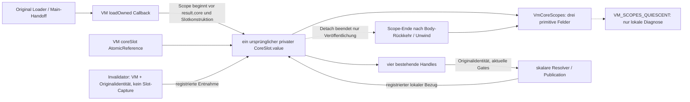

# §98a – Laufende VM-Core-Zugriffe

Basis `8f69c196063be899c1e89258eed9aa53d9247768`, Issue #37 (ergänzend #34).

**CONFIRMED für die unten erfassten lexikalischen VM-Scopes. Globale
Owner-Beendigung weiterhin BLOCKED.** Keine Readmission, kein Reuse und kein
`OWNER_END_CONFIRMED` eingeführt. Die neue Diagnose ist privat und hat keinen
Abnehmer im Reader, Loader oder Ledger; Tests inspizieren sie per Reflection.

## Änderung und Referenzgraph

Der ursprüngliche private `ProductViewModel.CoreSlot` besitzt genau einen
`VmCoreScopes`. Dieser enthält ausschließlich `active: Long`, `published: Boolean`
und `broken: Boolean`; keinen Slot-, Payload-, Lifetime-, VM- oder Schlüsselverweis.
Die Slotidentität bindet die Metadaten durch diese eindeutige Zuordnung, nicht
über eine zweite Registry. Weder historische Slots noch Diagnosen werden gesammelt.

Produktquellen:
[ViewModel](../../app/src/main/kotlin/org/pag/prototype/product/ProductViewModel.kt),
[gemeinsame Metadatenbuchung](../../domain/src/main/kotlin/org/pag/domain/CompactPresentationBudget.kt).
Der tatsächliche kompilierte Metadatentyp ist in
[scope-class-shape.txt](scope-class-shape.txt) dokumentiert; ein zusätzlicher Test
prüft auch die tatsächlichen Capture-Felder des Invalidators auf fehlende
`CoreSlot`-/`Value`-/`Payload`-Referenzen. Der bestehende VM-Link des Invalidators
bleibt ausdrücklich sichtbar und ist kein global beendeter Ownerlink.

## Vertrag und Synchronisation

- Vor Entnahme eines vorhandenen Slots wird dessen Registrierung zusammen mit der
  Identitätsprüfung unter dem kurzen `coreSlot`-Monitor serialisiert. Kein Slot wird
  für Datenzugriff oder externe Arbeit aus diesem Abschnitt herausgegeben, bevor
  sein Zähler erhöht wurde. Auch Detach und Änderung von `published` sind darin
  serialisiert. Die kurzzeitige interne Auswahlreferenz vor dem Increment kann
  nicht mit einem erfolgreichen Detach/Null-Diagnosezustand konkurrieren.
- `withCoreScope` quittiert ausschließlich seinen eigenen lexikalischen Eintritt
  im `finally`. Navigation besitzt denselben Acquire/Finally-Vertrag. Installation
  beginnt mit `active=1`, bevor `result.core` und der Slot aufgebaut werden, und
  quittiert in ihrem äußeren `finally`.
- Diese Endpunkte liegen nach Rückkehr beziehungsweise Exception-Unwind der
  erfassten Bodies. Sie sind **kein externes Signal, dass der gesamte aufrufende
  Java-Stack oder jeder Parameter physisch verschwunden ist**. Insbesondere der
  äußere Loader-/Main-Callback benötigt weiterhin seine eigenen realen ACKs.
- Keine übertragbaren Scope-Tokens und keine `ack(identity)`-API: Späte oder doppelte
  Callback-Aufrufe können keinen fremden Endzähler auswählen. Jede erfolgreiche
  Scope-Akquisition besitzt genau einen lexikalischen Finally-Ausgang, einschließlich
  nichtlokaler Returns und Exceptions. Eine abgelehnte Akquisition quittiert nichts.
- `enter` prüft den Long-Zähler vor Addition. Erschöpfte, negative oder ungültig
  beendete Metadaten werden dauerhaft `broken`; niemals Wraparound, Unterlauf oder
  Rückkehr zu einer positiven Diagnose. Normale Datenzugriffe werden dann verweigert.
  Der explizite Revoke-Pfad darf trotzdem synchron entkoppeln; die Diagnose bleibt
  dauerhaft `NOT_QUIESCENT`, statt eine unbewiesene Null zu erzeugen.
- Diagnose: ausschließlich `!broken && !published && active == 0` ergibt
  `VM_SCOPES_QUIESCENT`. Ein veröffentlichter Slot mit null laufenden Scopes ist
  weiterhin `NOT_QUIESCENT`. Nach Detach können alte Handles keinen neuen Scope
  dieses Slots erwerben. Ein bereits laufender Scope bleibt bis zu seinem Ende gezählt.
- Unter den Monitoren wird nur bounded Metadatenarbeit ausgeführt. Session-/Lifetime-
  Publication, Close, Subscription-Cancel, Dispatch, Repository- und UI-Arbeit laufen
  außerhalb des `coreSlot`-Monitors. Lock/Revoke warten nicht auf fremde Callback-
  Bodies, UI-Frames oder GC. Die vorhandenen Session-Publication-Monitore bleiben
  unverändert; der Testadapter behauptet kein verbotenes Interleaving darin.

## Tatsächliche Eintritts- und Endpunkte

| Teilpfad | Eintritt vor relevantem Daten-/Slotgebrauch | Quittierung / Grenze | Einstufung |
| --- | --- | --- | --- |
| Ursprüngliche Installation und Publication | Initialer Scope vor `result.core`, Validierung und `CoreSlot`-Konstruktion | Äußeres Callback-`finally`, auch bei Reject, Revoke oder Exception; umfasst den vollständigen synchronen `lifetime.publish`-Aufruf | **CONFIRMED** lokale Erfassung; Loaderparameter und äußeres Main-ACK bleiben getrennt |
| Vier Handle-Getter | `presentation` → `withCoreScope`, Originalslot unter Monitor registriert | Nach Validierung und Auswahl des bestehenden Handles, `finally` | **CONFIRMED**; kein Slot verlässt die produktive Handle-Ausgabeschnittstelle |
| HUB/PERSONS/TASKS/FUNCTIONS-Scalar | Mainthread, Originalidentität und Zählerregistrierung vor Autorisierung/Payloadzugriff | Nach `authorizeHit`, Publication, abschließender Prüfung und Body-Rückkehr/Unwind | **CONFIRMED**; Revoke im Publisher erzeugt noch keine Quieszenz |
| Invalidation, auch Fremdthread | Identitätsgebundenes `withCoreScope(..., revoking=true)` vor lokalem `held` außerhalb des Monitors | Nach synchroner Handle-Trennung und Rückkehr des unmittelbaren Dispatch-Aufrufs, `finally` | **CONFIRMED**; ein wartender Dispatch hält den Scope aktiv |
| Verzögerte Dispatch-Benachrichtigung | Callback erfasst nur VM/`coreSignal`, keinen Originalslot | Kein weiterer Original-Slot-Scope nötig; der Invalidator quittiert nach Rückkehr des Enqueue-Aufrufs | **CONFIRMED** für fehlenden direkten Originalslot-Capture, keine globale VM-Owner-Endaussage |
| Clear/Lock/Drop und `CoreSlot.close` | Registrierter Revoke-Scope vor Detach; Caller-Scope umfasst Close/Cancel/Lifetime | Erst nach Rückkehr/Unwind von Close; verschachtelte Invalidatoraufrufe suchen weiterhin die Originalidentität | **CONFIRMED** für lokale Scopes; Autorität/alle vier Links werden synchron entzogen |
| Composition-Metadatenaufrufe | Identitätsgebundener Scope vor Lifetime-Zugriff | `finally` nach vorhandener observed/disposed-Methode | **CONFIRMED** für diesen Aufruf; Dispose selbst beendet keine Veröffentlichung |
| Navigationskandidat / bestehende interne Validierer | Registriertes `acquireCoreScope` nur bei bestehendem Hit-Testpfad | Äußeres Navigations-`finally`, auch bei Return/Exception | **CONFIRMED**; produktive Reuse-Schalter bleiben aus |
| Doppelte Load-Callbacks | Registrierter kurzer Lifetime-Vergleich am aktuell veröffentlichten Slot, keine Payloadauflösung | Lokales `finally`; alte Lifetime wird nur gemäß bestehendem Vertrag geschlossen | **CONFIRMED**; kein alter Endreceipt wird auf B angewandt |
| Vollständige Owner-/Originaldaten-Beendigung | Erfordert mehr als Scopezähler/Detach | Fehlender globaler Vertrag; `CoreSlot.value` bleibt unverändertes `val`, Testholder kann es weiter halten | **BLOCKED**, keine Freigabe abgeleitet |
| Alte Read-/Owner-Verbindungen zu späteren Kandidaten | §97a: alter MainHandoff → inner Read → Owner.current → B | In §98a nicht umgebaut; Gegenfall bleibt erhalten | **BLOCKED**, eigenständiger offener Befund, kein Autoritätsbypass behauptet |
| Fullview-/Formular-/Editorzustände; Framework-/Native-/Text-/Render-/IME-/Accessibility-Kopien | Separate Zustände/Ressourcen | Nicht durch diese Scopes integriert oder beendet | **OUT OF SCOPE**, weder kostenlos noch gelöscht angenommen |

## Admission und unveränderte Sicherheitsgrenzen

Ein zusätzlicher Metadatencontainer und eine Slot→Metadatenreferenz werden
**vor Materialisierung** in der bereits gemeinsam verwendeten
`CompactPresentationBudget.reservation` disjunkt gebucht: **136 Bytes Retained und
136 Bytes Transition** gemäß bestehender Schätzformel (`128 + 8`). Fixe gemeinsame
Präsentationskosten sind dadurch R=2.728 / T=63.816 Bytes; variable FUNCTIONS-
Formatierung kommt wie bisher hinzu. Gemeinsamer Scratch wird weiterhin nur einmal
gebucht. Keine Pro-Aufruf-Tokenliste, keine Payloadkopie und kein zusätzlicher
Datenroot; die Scope-Wrapper sind inline und verwenden primitive Stackmetadaten.
Der kompilierte [Scope-Eintritt](scope-entry-bytecode.txt) enthält keine `new`-/Array-Allokationsanweisung. Die Beträge sind Ledger-Engineeringansätze, keine zertifizierten ART-/Native-Größen.

Retained **8.388.608** und Transition **16.777.216 Bytes** bleiben gleich.
Die bestehenden exakten R-/T-Grenztests einschließlich +1 Byte berücksichtigen nun
den Metadatencontainer. Gemeinsamer Reader, CoreReadAdmission-Mechanik,
OutstandingCoreRead, Session, READY/Generation/Action, Writer-Pending/UNKNOWN,
Revoke, Crypto, Storage und alle Publication-Autorisierungen bleiben unverändert.
[Blobvergleich der unveränderten Verträge](unchanged-contracts.json).

Insbesondere gibt es **keine Verbindung von `VmCoreScopes` zu
`OutstandingCoreRead`**. Dessen `exposed`-Sperre bleibt geschlossen. Weder leere
VM-Felder noch `onDispose`, `onDraw`, GC oder die neue Diagnose senden irgendein
Retire-/Freigabesignal. `reuseEnabled=false`, `ramReuseEnabled=false` und die
Sperre automatischer Readmission bleiben bestehen. Keine produktive Schnellnavigation.

## Gezielte Gegenbeispiele und Testbilanz

[Testquelle VM](../../app/src/test/kotlin/org/pag/prototype/product/ActiveCoreOwnerTest.kt):
12 neue `p98…`-Fälle, zusätzlich alle bisherigen 41 Fälle (einschließlich vier
funktionierender Handles, Generation/Action, Writer-/UNKNOWN-/Revoke- und später
Callback-Grenzen). Die Testaliases von Slots/Metadaten und manipulierten Felder
sind ausdrücklich **Testreferenzen beziehungsweise Fault Injection**, keine
Produktowner oder echten Vendorfehler.

| Gegenfall | Beobachtung |
| --- | --- |
| VM-Feld leer / vier Links weg, Resolver noch im Publisher | active=1, `NOT_QUIESCENT`; nach Scope-Rückkehr active=0, nur `VM_SCOPES_QUIESCENT` |
| Verschachtelte Resolver mit Revoke | Zählerfolge 1/2/1/0; keine vorzeitige Null |
| Fremdthread-Invalidator im kontrolliert pausierten Dispatch | Alle Links bereits weg, active=1; Lock kehrt vor Freigabe des fremden Callbacks zurück; erst danach lokale Null |
| A-Callback noch aktiv, Test-Port installiert B | A bleibt aktiv; dessen spätere Rückkehr ändert B weder Veröffentlichung noch Nullzähler; **keine produktive Readmission** |
| Resolver-, Installations- oder Dispatch-Exception | Jeweils Scope-Finally ausgeführt; veröffentlichter Slot bleibt bis zum Widerruf `NOT_QUIESCENT`; bestehende Exceptionpolitik unverändert |
| Revoke im ursprünglichen Publisher / abgelehnte Publication | Initialer Scope bleibt bis zum Callback-Finally aktiv, alle Links widerrufen |
| Alte/doppelte Callback-Identität oder falsches Handle | Keine Wiederinstallation, kein Zugriff auf B-Daten und kein Endreceipt für B |
| Injizierter Zählerüberlauf / doppeltes End nach Null | Kein Wrap/Unterlauf, dauerhaft negative Diagnose; Revoke bleibt funktionsfähig |
| Tatsächliche Capture-Form | Scopeobjekt nur Primitive; Invalidator ohne Slot-/Value-/Payload-Capture |
| Wiederholte Composition-Signale | Veröffentlicht bleibt `NOT_QUIESCENT`; keine Freigabe |
| Expliziter Testholder nach lokaler Null | `CoreSlot.value` weiterhin erreichbar; lokales Ergebnis ist kein vollständiger Endnachweis |

Ergänzend: [Admissiontests](../../data/src/test/kotlin/org/pag/data/product/CoreReadAdmissionBudgetTest.kt)
(6), [Ledgertests](../../app/src/test/kotlin/org/pag/prototype/product/ActiveWorkspaceBudgetTest.kt)
(14), echte bestehende [Lifetime](../../data/src/test/kotlin/org/pag/data/product/ProductActiveCoreLifetimeTest.kt)
(12) und [Outstanding](../../data/src/test/kotlin/org/pag/data/product/OutstandingCoreReadTest.kt)
(16), sowie die acht [§97a-Referenzgegenfälle](../../data/src/test/kotlin/org/pag/data/product/P97CoreReferenceLifetimeTest.kt).
Letztere erhalten insbesondere den tatsächlichen Expositions-/Readmission-Blocker
und den alten Read→Owner→B-Befund.

**109 unterschiedliche Hostfälle PASS, 0 Fehler, 0 Failures, 0 Skips.** Wiederholte
Entwicklungsdurchläufe werden nicht mehrfach gezählt. Betroffene Produktions- und
Testquellen wurden durch die Hosttasks kompiliert. Kein Android-/Gesamtsuitenlauf,
kein Benchmark und kein zusätzlicher Releasebuild. Die neue Synchronisation und der
kontrollierte Fremdthreadvertrag sind direkt mit echten JVM-Threads/Latches getestet;
ein Gerätetest würde hier keinen zusätzlichen erforderlichen Androidvertrag prüfen.
Keine Speicher-/Wipeaussage aus Hosttests oder Heap-Samples.

Rohbelege: [Befehle](commands.sh), [erste Bestandsprüfung](initial-host-tests.log),
[erster gezielter Lauf](host-tests.log), [finale VM-/Admissionprüfung](final-owner-budget-tests.log),
[finale Handoffprüfung](final-handoff-tests.log), [JUnit-XML](junit/),
[deduplizierte Bilanz](test-summary.json), [ausgelesene Beobachtungen](reference-observations.txt).

**STOPP zum unabhängigen Review.** Keine weitere Ownerarchitektur, kein Merge/Release.
