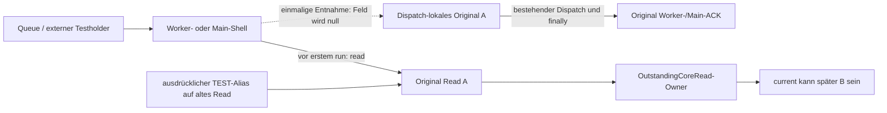

# §99a – Terminale Worker-/Main-Shells entkoppeln

Basis `85e836a3b18fde6bb348fa0b0f64699025d9bfed`, #37/#34.
**CONFIRMED für die Shell-Entkopplung und die geprüften Originalquittierungen.**
Kein vollständiger Owner-Endnachweis und keine neue Readmission.

## Kleiner Produktcode-Eingriff

Ausschließlich `WorkerHandoff` und `MainHandoff` in
[OutstandingCoreRead.kt](../../data/src/main/kotlin/org/pag/data/product/OutstandingCoreRead.kt)
ändern sich: Das bisher dauerhafte `val read` ist ein nullable `var read`.
Der erste `run()` entnimmt das ursprüngliche Objekt unter `synchronized(this)`
und setzt das Feld in demselben kurzen Abschnitt auf null. Der Dispatch erfolgt
**außerhalb** dieses Monitors. Alle weiteren Aufrufe erhalten null und kehren zurück.

Die tatsächliche Queueverwendung bleibt unverändert:
`ProductActiveCoreLoader.loadOwned → Read.queueWorker → worker.execute(shell)` und
nach dem Worker `Read.queueMain → main.execute(shell)`.
Queue-/Executor-Rejection und unbestätigte Queueannahme behalten ihren bisherigen
Vertrag. Cancellation leert weiterhin die Work-/Payloadzellen, nicht vorzeitig
das noch benötigte Shellfeld. Keine Cancel-Methode erzeugt eine neue Shellquittierung.

Nach Entnahme existiert **keine Shell→Read-Kante** mehr. Der tatsächliche Dispatcher
behält seinen Originalreceiver bis zu seinem vorhandenen `finally`: Worker über
`workerFinished`, Main über `mainAcknowledged/retireIfEnded` (zusätzlich zur
bestehenden Delivery-Quittierung `mainFinished`). Die Entnahme selbst verändert
keines dieser Felder und ist kein Admission-/Retirement-Signal.
Die bestehenden Dispatch-CAS bleiben als zusätzliche Identitätssicherung erhalten.

Der [Source-Scope-Nachweis](scope-guard.txt) prüft den gesamten `Read`-Rumpf sowie
den Code vor den Shells bytegleich zur Basis. [Blobvergleiche](unchanged-contracts.json)
belegen unveränderte Loader-, Lifetime-, Admission-, Session-, Budget- und VM-Quellen.

## Gegenprüfungen und Grenzen

Alle Tests verwenden den echten `OutstandingCoreRead`. Die Loaderfälle verwenden
auch den echten `ProductActiveCoreLoader` und dessen Lifetime; Storageproducer und
READY-Adapter sind synthetisch, ohne DB-/Crypto-/Native-Freigabeaussagen.
[Testquelle](../../data/src/test/kotlin/org/pag/data/product/P97CoreReferenceLifetimeTest.kt).

| Situation | Beleg / Einstufung |
| --- | --- |
| Worker noch nicht ausgeführt, auch nach Cancel | Originalfeld bleibt identisch; `workerEnded=false`, Admission verweigert. Erst tatsächlicher Shellaufruf quittiert. **CONFIRMED** |
| Worker während Materialisierung | Shellfeld bereits null; Producer hält Originaldaten lokal, Worker-ACK fehlt, Cancel erlaubt keine zweite Admission. Nach Rückkehr ACK und Shell weiterhin null. **CONFIRMED** |
| Main noch nicht ausgeführt, auch nach Cancel | Originalfeld vorhanden; `mainAcknowledged=false`, keine vorzeitige Wiederzulassung. **CONFIRMED** |
| Main während tatsächlichem Owner-Callback | Shellfeld null; lokales Ergebnis lesbar, `delivering=true`, `mainAcknowledged=false`. Gleichzeitige Duplikate erzeugen kein ACK. **CONFIRMED** |
| Main nach Rückkehr | Originale Main-/Delivery-ACKs gesetzt, Shellfeld null. Bei Exposition bleibt Admission dennoch verweigert. **CONFIRMED** |
| Acht parallele erste Workeraufrufe | Genau ein Producer; Cancel während laufender Arbeit wartet auf tatsächlichen Workerabschluss. **CONFIRMED** |
| Acht parallele erste Mainaufrufe | Direkter echter Outstanding-Dispatch: genau eine Workausführung; Cancel währenddessen bleibt bis zum Main-ACK gebucht. Zusätzlich Loader-Callback mit acht fremdthreadigen Duplikaten während des laufenden Owneraufrufs. Kein erster produktiver Main-Dispatch auf einem Foreignthread behauptet. **CONFIRMED** |
| Exceptions | Synthetische Dispatch-Exceptions an echtem Worker/Main sowie Loader-Callback-Exception: bestehende Finally-/Delivery-ACKs erhalten, Shell leer. Kein echter Vendorfehler behauptet. **CONFIRMED** |
| Unveröffentlichter A vollständig quittiert | B kann nur nach den bisherigen Revoke-/Worker-/Main-/Storage-/Key-Bedingungen beginnen. Alte Shell-Duplikate ändern weder B noch dessen State/Buchung. **CONFIRMED** |
| Testweise gehaltene ausgeführte Worker-/Main-Shell | Beide Felder null; begrenzte identitätsbasierte Graphinspektion findet keinen Pfad zu B. **CONFIRMED** für diese Shells, kein physischer Heap-/Wipebeweis |
| Ausdrücklicher alter `Read`-Testalias | Die separat aktualisierte §97a-Gegenprobe findet weiterhin `Read.this$0 → owner.current → B`. **BLOCKED** für diese andere Verbindung; kein produktiver Zusatzowner oder Autoritätsbypass behauptet |
| Exponierter Core, auch nach Callback-Close/ACK | `retireIfEnded` bleibt bei `exposed=true` gesperrt, neue Admission **DENIED**. **BLOCKED** für globale Beendigung/Reuse, absichtlich unverändert |
| VM-/Lifetime-/Fullview-/Formular-/Editor- und Framework-/Native-Referenzen | Hier nicht neu integriert oder global entkoppelt. **OUT OF SCOPE**, nicht kostenlos oder physisch gelöscht angenommen |

Die historische §97a-Dokumentation und ihre damaligen Rohbelege bleiben bestehen.
Der aktualisierte Test heißt
`retiredShellIsDetachedButExplicitOldReadAliasStillReachesFutureCandidate`: Er
unterscheidet ausdrücklich die reparierten Shellkanten vom weiterhin bestehenden
**Testalias auf Read**. Die Aliasreferenzen sind ausschließlich Testinstrumente.

## Budgets und Sicherheitsverträge

Kein neues app-kontrolliertes Objekt, keine zweite AtomicReference, Registry,
Payloadkopie oder Queueinstanz. Pro bestehender Shell bleibt genau ein Referenzfeld;
`val → nullable var` ändert nur seine Entnehmbarkeit. Der lokale Receiver ist ein
Alias des Originals. Der [kompilierte Shellcode](shell-bytecode.txt) zeigt ein
Referenzfeld je Shell und keine neue Allokationsanweisung in `run()`.
Für zusätzliche native Monitor-/Runtimekosten wird weder Nullbelegung noch eine
harte Heapobergrenze behauptet; solche Ressourcen bleiben gemäß Option 2 separat.
Feldleerung wird nicht als physische Freigabe verkauft.

Retained **8.388.608 Bytes**, Transition **16.777.216 Bytes** und die gemeinsame
Admission bleiben unverändert. Keine zusätzliche Payloadlebensdauer durch die
Shelländerung; laufende Dispatcher halten ohnehin ihren Originalreceiver.
Session-, READY-/Ticket-, Writer-/UNKNOWN-, Revoke-, Publication-, Storage-/Key-
und Cancellationregeln unverändert. Der komplette `Read`-Rumpf ist unangetastet.

`reuseEnabled=false`, `ramReuseEnabled=false`, Retirement nach Exposition,
automatische Readmission und produktive Schnellnavigation bleiben gesperrt.
Keine Verbindung zu `VmCoreScopes` und kein globaler Owner-Endreceipt eingeführt.

## Tests und Rohbelege

**41 unterschiedliche gezielte Hostfälle PASS, 0 Failures/Errors/Skips:**
13 Referenz-/Shellfälle (bisherige acht entsprechend aktualisiert plus fünf neue),
16 [Outstanding-Fälle](../../data/src/test/kotlin/org/pag/data/product/OutstandingCoreReadTest.kt),
12 [Lifetime-Fälle](../../data/src/test/kotlin/org/pag/data/product/ProductActiveCoreLifetimeTest.kt).
Die bestehenden Fälle erhalten insbesondere verlorene Queue-ACKs, Queuefehler,
Storage-/Key-Cleanup, Writer-/UNKNOWN-/Sessionraces und Expositionssperren.

Betroffene Produktions-/Testquellen durch den Hosttask kompiliert. Keine Gesamtsuite,
kein Gerätetest, Performancebenchmark oder zusätzlicher Releasebuild. Die relevante
Konkurrenz wird mit echten JVM-Threads und Latches geprüft, ohne GC-/WeakReference-
oder Compose-Endheuristik. Kein zusätzlicher Androidvertrag geändert.

[Befehle](commands.sh), [erster Lauf mit 40 Fällen](host-tests.log),
[finaler Lauf mit 41 Fällen](final-host-tests.log), [JUnit-XML](junit/),
[deduplizierte Bilanz](test-summary.json), [Beobachtungen](reference-observations.txt).

**STOPP zum unabhängigen Review. Kein Merge/Release.**
